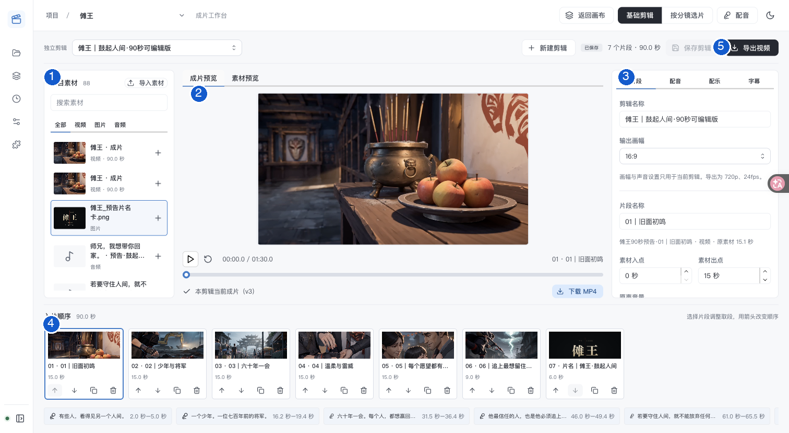

# 使用指南

[← 项目首页](../README.md) · [首次使用](getting-started.md) · [配置模型](model-setup.md)

先选你要完成的任务。每份指南都从操作入口开始，按步骤说明结果；接口、源码和历史验证放在页面底部的折叠区。

## 第一次使用

**[启动项目](../README.md#快速开始) → [接入模型](model-setup.md) → [完成第一条创作流程](getting-started.md)**

## 按任务找指南

| 我想做什么 | 打开哪份指南 | 完成后得到什么 |
| --- | --- | --- |
| 添加 API Key，让模型可用 | [配置模型服务](model-setup.md) | 可用于创作的文本、图片或视频模型 |
| 从创意开始写剧本 | [阶段创作](model-intent-workflow.md) | 确认保存的大纲、设定和分集正文 |
| 上传已有剧本，讨论或修改 | [原稿上传与修订](script-source-context.md) | 保留原稿的讨论、分析和待确认修订 |
| 修改镜头、调整顺序、回收恢复 | [分镜管理](shot-management.md) | 整理好的镜头与画布引用 |
| 用多张画布整理或比较方案 | [项目多画布](project-canvases.md) | 分开的工作区域或独立分镜方案 |
| 给角色、场景和道具选择参考图 | [多视角参考](multi-angle-reference-workflow.md) | 已确认并绑定到镜头的参考图 |
| 制作对白与旁白 | [配音制作与入片](tts-standard-voice-workflow.md) | 选好的音频及成片中的播放位置 |
| 剪辑素材、加字幕并导出 | [基础剪辑](basic-final-cut.md) | 可下载的 MP4 |
| 刷新或重启后找回生成任务 | [图片与视频任务恢复](generation-restart-recovery.md) | 原任务的进度与可下载结果 |

## 界面从哪里看？

下面是仓库已有样片的基础剪辑界面。点击图片可放大；编号对应下方的操作区域。

| 编号 | 区域 | 常用操作 |
| --- | --- | --- |
| 1 | 项目素材 | 导入素材，点击「＋」加入剪辑 |
| 2 | 成片预览 | 播放并检查画面、声音与字幕 |
| 3 | 编辑面板 | 调整片段、配音、配乐和字幕 |
| 4 | 入片顺序 | 选择、排序和复制片段 |
| 5 | 保存与导出 | 保存编排、导出视频，再下载 MP4 |

截图来源为 2026-11-01 的仓库验收记录，编号为文档标注。详细步骤见[基础剪辑指南](basic-final-cut.md)。

## 遇到问题

| 现象 | 先看这里 |
| --- | --- |
| 模型不在生成列表中 | [模型配置常见问题](model-setup.md#常见问题) |
| 回复已完成，项目文档却没变化 | [草稿确认保存](model-intent-workflow.md#3-查看草稿并确认保存) |
| 不清楚删画布会影响什么 | [删除画布](shot-management.md#删除画布) |
| 图片、视频任务中断或下载失败 | [任务恢复](generation-restart-recovery.md) |
| 剧本长任务中断、停止或需要继续 | [剧本任务恢复](script-task-recovery.md) |
| 导出的内容还是旧版本 | [保存与导出](basic-final-cut.md#保存与导出) |

更多功能：提示词、镜头引用与画布操作

## 画布、视觉与成片

| 文档 | 适用情况 |
| --- | --- |
| [镜头引用](shot-reference-usage.md) | 调整出镜范围、参考图用途与版本 |
| [图片反推提示词](image-prompt-analysis.md) | 从图片提取提示词 |
| [视频反推提示词](video-prompt-analysis.md) | 从视频整理逐镜头提示词 |
| [Seedance 2.0 提示词](seedance-2-0-prompt-workflow.md) | 使用对应模型整理视频提示词 |
| [导演节点修改方案](canvas-node-proposals.md) | 查看并确认节点调整提案 |
| [生成提交与恢复](generation-submission-recovery.md) | 理解重复提交与候选找回 |

开发者参考：目录、协议与模型执行规则

## 项目概览与开发

| 文档 | 用途 |
| --- | --- |
| [项目目录规范](project-structure.md) | 工作区、模块边界与开发命令 |
| [前端设计系统](frontend-design-system.md) | Mantine、样式令牌与交互约定 |
| [产品分析](product-analysis.md) | 产品范围与早期需求记录 |
| [多节点画布性能](canvas-performance.md) | 渲染、媒体预览与容量策略 |
| [节点上下文与资源续读](canvas-node-context-and-resource-reads.md) | 大型资源的有界读取 |

## 剧本、原文与模型上下文

| 文档 | 用途 |
| --- | --- |
| [模型交互机制](model-interaction-controls.md) | 提示词、结构化输出与工具调用 |
| [分析成本控制](script-analysis-cost-control.md) | 缓存、预算与用量作用域 |
| [剧本质量增强](script-quality-enhancements.md) | 核对、修订与保存校验 |
| [文本模型上下文容量](text-model-context-capacity.md) | 容量配置与超限处理 |
| [文本模型输出限制](text-model-output-limits.md) | 输出上限与协议字段 |

历史资料：调研、样片与带版本的验证记录

## 调研与历史记录

| 文档 | 记录内容 |
| --- | --- |
| [功能与验证记录](current-status.md) | 2026-10-22 基线的构建、测试与当时缺口 |
| [提供商协议调研](model-provider-integration-research.md) | 协议比较与带日期的兼容记录；配置操作请先看[使用指南](model-setup.md) |
| [成熟项目剧本编辑器分析](mature-project-script-editor-analysis.md) | 早期交互比较与实现映射 |
| [《听雷桥》样片审核](tinglei-bridge-quality-review.md) | 早期样片问题与当时工具范围 |
| [封面素材说明](../web/public/topic-art/covers/README.md) | 静态素材映射 |

历史文档中的能力、价格与测试结果只对应各自日期和版本。根目录的 [task_plan.md](../task_plan.md)、[findings.md](../findings.md)、[progress.md](../progress.md) 保留早期开发过程。

