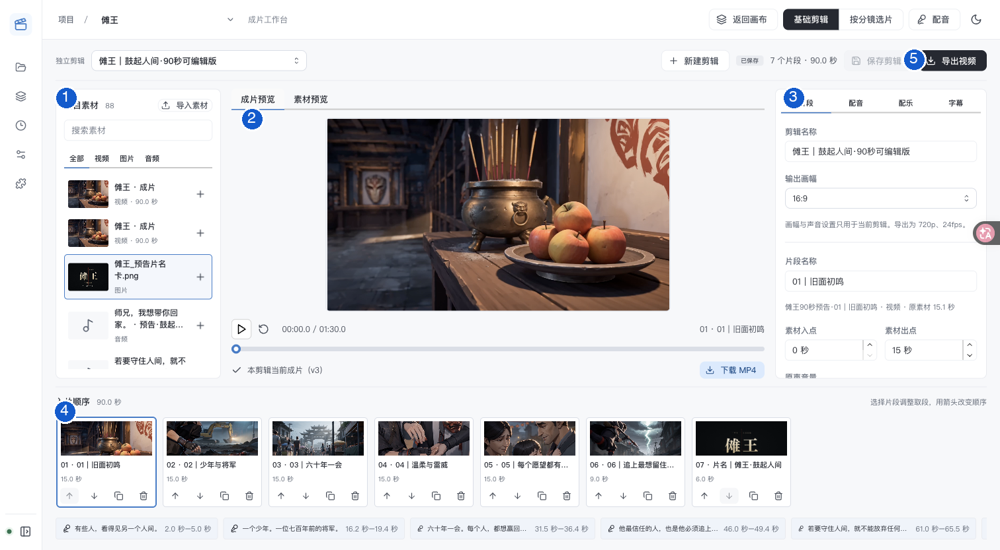

# 成片工作台：基础剪辑

[返回文档](README.md) · [制作配音](tts-standard-voice-workflow.md)

把已有图片、视频与音频编排成一份独立剪辑，调整取段，加入配乐和字幕，再导出 MP4。

**入口：** 项目左上角创作菜单 → **成片工作台** → **基础剪辑**。

[认识界面](#认识界面) · [完成第一份剪辑](#完成第一份剪辑) · [保存与导出](#保存与导出) · [常见问题](#常见问题)

## 先选择制作方式

| 方式 | 适合的任务 | 编排依据 |
| --- | --- | --- |
| **基础剪辑**（本页） | 自由组合素材、重复取段、制作字幕版 | 当前独立剪辑的时间线 |
| **按分镜选片** | 比较镜头候选、检查接镜、按分镜制作 | 分镜方案、每镜选片与制作范围 |

两种入口位于成片工作台顶部。独立剪辑的编排、声音和字幕分别保存，不会改写原分镜顺序。

## 认识界面

图中 1 为素材、2 为预览、3 为编辑面板、4 为入片顺序、5 为保存导出。点击图片可放大；截图来自 2026-11-01 的仓库样片记录。

| 位置 | 你可以做什么 |
| --- | --- |
| 顶部 **独立剪辑** | 选择或新建剪辑，查看保存状态，保存与导出 |
| 左侧 **项目素材** | 导入文件，筛选视频、图片、音频，点击“＋”加入时间线 |
| 中间 **成片预览 / 素材预览** | 查看剪辑效果或原素材，查看导出状态并下载 |
| 右侧 **片段 / 配音 / 配乐 / 字幕** | 编辑当前画面或声音，设置字幕正文与时间 |
| 底部 **入片顺序** | 选择、前移、后移、复制或移除画面片段 |

## 完成第一份剪辑

### 1. 新建并添加素材

点击 **新建剪辑**，填写名称。左侧点击素材旁的 **＋**，视频和图片加入画面轨道，音频加入配音轨道。没有素材时，先点击 **导入素材**。

### 2. 调整画面顺序与取段

点击底部片段，在右侧 **片段** 页调整素材入点、出点或图片停留时间。用片段旁的箭头改变顺序，也可复制同一素材，分别设置不同取段。

例如，原视频长 10 秒，入点设为 2 秒、出点设为 6 秒，这个片段在成片中播放 4 秒。原素材文件不被裁短。

### 3. 添加对白或旁白

右侧 **配音** → 选择 **添加音频素材** → **添加配音**。再选择要编辑的配音片段，设置成片开始位置、音频入出点与音量。

需要新音色或新台词时，点击 **制作配音**。生成候选后返回，点击 **刷新音频素材**，再添加或 **替换配音素材**。

### 4. 配置背景音乐

右侧 **配乐** 选择音乐与音量。可勾选 **配音时降低配乐**、**配音时降低视频原声**。配乐从成片起点播放，循环至结尾。

### 5. 添加字幕并预览

右侧 **字幕** → **添加字幕**，填写正文、开始与结束时间；也可在配音页点击 **用此配音创建字幕**。字幕会出现在成片预览和导出画面中。

横竖画幅会自动换行；单条超过四行时需要拆分。批量字幕文本每行一句，初始各停留 3 秒，添加后应逐句调整时间。

## 保存与导出

1. 点击 **保存剪辑**，确认顶部状态变为 **已保存**。
2. 切到 **成片预览**，检查画面顺序、声音与字幕时间。
3. 点击 **导出视频**；仍有修改时，按钮显示 **保存并导出**。
4. 等待中间预览下方显示当前版本成片，再点击 **下载 MP4**。

当前输出为 **720p、24fps、48kHz 立体声 MP4**，画幅可选 `16:9` 或 `9:16`。

## 常见问题

### 修改已经自动保存了吗？

本机草稿与服务器保存分开。未保存修改会暂存在当前浏览器会话，切换剪辑或离开时会提示；完成编辑后仍应点击 **保存剪辑**。

### 为什么下载入口显示“较早版本成片”？

剪辑修改后，之前的 MP4 不会自动更新。保存并重新导出，确认下载区显示 **本剪辑当前成片**。

### 保存冲突怎么办？

另一个窗口可能更新了同一剪辑。可 **重新读取服务器版本**，或将本机草稿 **另存为新剪辑**。

### 在这里换配音，会覆盖其他成片吗？

不会。每份独立剪辑保存自己的画幅、画面编排、配音版本、配乐、音量与字幕；项目素材、原分镜及配音页的选用结果分别保留。

开发参考：接口与既有样片记录

## 实现与验证

独立剪辑存于 `editing_cuts`，通过 `/api/projects/:id/editing-cuts` 创建、读取，PUT 带 `revision` 保存。导出接口 `/api/projects/:id/editing-cuts/:cutId/export` 接受指定 revision，任务保存画面、声音与字幕的不可变快照。

界面入口为 `web/src/features/final-cut/BasicFinalCutStudio.tsx`，保存与模式切换由 `web/src/app/App.tsx` 接入。本次整理核对了这些入口，未新增导出或真实模型验证。

已有《傩王》验收剪辑 `8eb3a92c0afe4818963cab40ffa4f2da` 使用六段源视频、片名图片、六条已选配音、配乐与六句字幕。历史导出及原数据保留检查见 `production/2026-11-01-nuowang-trailer/reference/basic-editor-*.json`。

