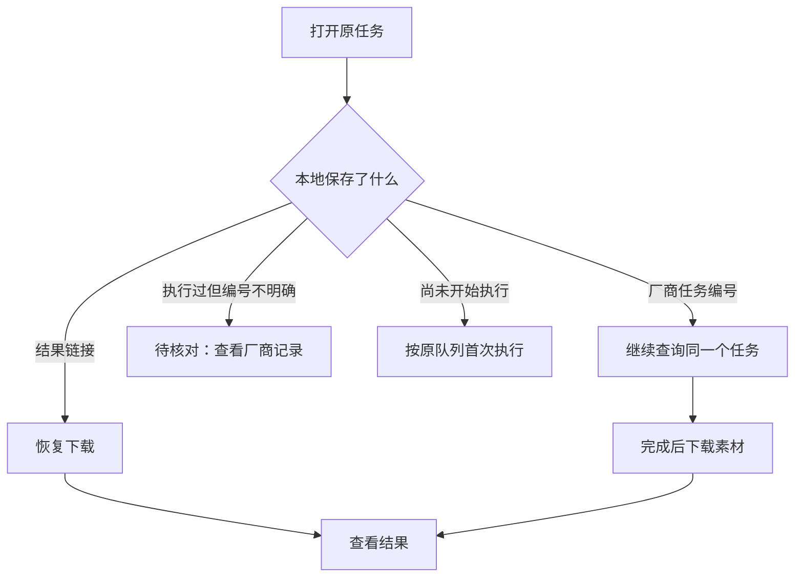

# 图片与视频生成的重启恢复

[返回文档](README.md) · [提交后没有收到响应](generation-submission-recovery.md)

**适用场景：** 生成过程中关闭服务、网络中断，或素材已生成但下载失败。先到项目的 **任务记录** 查看原任务，再根据页面提供的操作恢复。

[恢复步骤](#恢复步骤) · [状态怎么选](#状态怎么选) · [常见问题](#常见问题) · [边界与验证](#边界与验证)

## 恢复步骤

1. **重新启动服务，打开原项目。** 原来处于运行状态的图片、视频任务会根据已保存的记录恢复。
2. **进入“任务记录”，找到原任务。** 可按任务类型筛选，或搜索模型、镜头与任务 ID。
3. **查看“结果与操作”。** 仍在运行时等待更新；已失败时按下表选择“继续查询”或“恢复下载”。
4. **完成后点击“查看结果”。** 确认素材可播放，再回画布或成片工作台继续制作。

已失败的可恢复任务需要手动操作；重新打开服务不会把所有失败任务都重新执行。

## 状态怎么选

| 页面显示 | 接下来做什么 | 处理结果 |
| --- | --- | --- |
| 生成中 / 排队中 | 等待，必要时点击“刷新” | 原任务继续更新状态 |
| 继续查询 | 点击该按钮 | 查询同一个厂商任务编号 |
| 恢复下载 | 点击该按钮 | 下载已生成的结果 |
| 待核对 | 核对服务商任务记录与账单 | 明确旧任务是否已经执行，再决定后续操作 |
| 已完成 | 点击“查看结果” | 打开已保存的本地素材 |

恢复查询和下载不会重新提交图片或视频生成。想修改提示词时，请先处理旧任务，再明确创建新生成任务。

## 常见问题

### 为什么只有“待核对”，没有普通重试？

服务可能已接收请求，但本地没有可靠保存任务编号。此时再次提交可能重复生成。核对服务商记录后，再决定是否在画布新建任务。

### 为什么改过模型后不能继续查询？

查询需要与原任务的接口配置匹配。还原原模型和提供商配置后再试；停用或归档的配置也需重新启用。修改显示名称、轮换密钥不会单独触发配置不匹配。

### 原模型删除了，还能拿回结果吗？

已经保存结果链接时，可以直接恢复下载，不依赖原模型、提供商或参考素材。只有任务编号时，仍需要可用且匹配的查询配置。

### 结果链接过期怎么办？

下载失败会保留原记录，不会自动改为重新生成。请结合服务商记录确认能否重新获取结果链接。

## 边界与验证

- 本页适用于图片、视频任务。配音中断后需核对计费，再手动生成新候选，见[配音指南](tts-standard-voice-workflow.md)。
- 恢复机制不能保证服务商的计费结果，也不代表服务商支持重复请求去重。
- 旧任务没有历史配置指纹时，无法完整证明它最初使用的配置；恢复前应结合服务商记录核对。

开发参考：保存顺序、配置核对与历史验证

## 保存顺序与故障处理

| 时点 | 持久化内容 | 写入失败时 |
| --- | --- | --- |
| 第一次执行前 | `job_generation_attempts` 保存执行类型与模型、提供商配置指纹 | 停止执行并保留核对状态 |
| 收到任务编号 | 先写回原任务，再查询 | 不再次提交生成 |
| 收到结果链接 | 图片写入 `job_image_recovery`，视频加密写入 `job_video_recovery` | 停止下载；已有编号仍可继续查询 |
| 素材入库 | 原任务成功状态与业务更新在同一事务提交 | 回滚时保留恢复链接 |

事务提交成功后才清理结果链接。已有任务编号的查询不再读取原始参考素材。

## 配置变化

查询比对模型 ID、提供商 ID、远端模型名、协议、完整模型设置，以及提供商适配器、地址与认证头配置。对象键顺序、密钥轮换和显示名称变化不影响比对。

旧任务首次恢复时会保存当前指纹，但不能据此追溯升级前的全部变化。正常服务启动会创建所需表，无须手工改写历史任务。公开项目接口不返回厂商结果地址。

原文验证记录使用临时数据库、模拟厂商与独立子进程，覆盖配置漂移、持久化失败、下载失败、事务回滚和重启恢复；未调用付费模型，也未重启正在使用的服务。本次文档整理未重跑这些验证。

