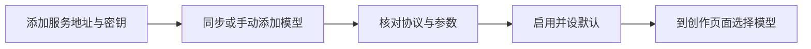

# 配置模型服务

[← 使用指南](README.md) · [下一步：开始创作](getting-started.md)

把你选择的服务地址、API Key 和模型接入工作台。首次安装的模型列表为空；先配好文本模型，就能开始剧本讨论与分镜规划。

**入口：** 左侧导航 → **模型设置**。

[添加提供商](#1-添加提供商) · [添加模型](#2-同步或手动添加模型) · [核对配置](#3-核对类型协议与参数) · [启用与默认](#4-启用并设置默认模型) · [常见问题](#常见问题)

## 开始前准备

| 信息 | 从哪里取得 | 示例 |
| --- | --- | --- |
| API 地址 | 所选服务的接口文档 | `https://api.example.com/v1` |
| API Key | 服务账户的密钥管理页 | 使用自己的密钥 |
| 模型 ID | 模型目录或接口文档 | 使用服务实际提供的 ID |
| 接口协议与能力 | 对应模型的接口说明 | 文本工具调用、参考图、异步任务等 |

示例地址仅说明填写格式。模型名称相同，不代表不同服务的接口与能力相同。

## 1. 添加提供商

1. 点击 **添加提供商**，填写方便识别的名称与 API 地址。
2. 打开该提供商，在 **连接配置** 中填写 **API 密钥**，按 Enter 或点击输入框外触发保存。
3. 等待字段保存完成，确认页面显示 **已保存密钥**，并打开 **启用提供商**。

仅填域名时会补上 `/v1`；已含接口路径时保留原路径。按服务文档填写完整地址，避免重复添加路径。

**你会看到：** 提供商出现在左侧列表，右侧显示连接配置及模型区域。密钥保存后不会以原值返回页面。

## 2. 同步或手动添加模型

| 方式 | 操作 | 适合什么情况 |
| --- | --- | --- |
| **同步模型** | 获取目录，搜索并选择模型后添加 | 服务提供模型列表接口 |
| **手动添加** | 填写显示名称、模型 ID、类型和协议 | 无目录接口，或目录中没有所需模型 |

同步模型只读取目录，不会生成图片或视频。同步导入的模型默认停用，需要先检查配置再启用。

**你会看到：** 模型按文本、图片、视频分组。目录读取成功仅证明目录可访问，尚未证明生成接口可用。

## 3. 核对类型、协议与参数

| 类型 | 先核对什么 | 主要用途 |
| --- | --- | --- |
| 文本 | Chat Completions 或 Responses；剧本流程还需工具调用 | 讨论、写作、分镜与提示词整理 |
| 图片 | 提交方式、参考图、尺寸及结果或任务解析 | 设定图与分镜图生成 |
| 视频 | 创建任务、查询状态、视频下载地址及参考输入 | 生成视频候选 |

### 文本模型

填写服务支持的协议、模型 ID 和上下文设置。只有服务明确支持看图或视频理解时，才开启对应能力；普通文本回复可用不代表工具调用可用。

### 图片模型

在 **图片生成设置** 中检查 **请求配置**。当前表单的「Images API · 异步任务」采用特定的提交与查询契约，使用前应对照服务文档核对。

依次确认参考图用途、传递方式、画幅或像素尺寸，并展开 **连接与任务查询** 检查实际地址。自定义或同步接口需使用与其匹配的高级请求配置，不能直接套用异步表单。

### 视频模型

按服务实际接口填写任务创建、查询与结果映射，核对时长、清晰度和参考图要求。带有具体型号的配置按钮只适用于对应接口，应用后仍需检查并保存。

高级 JSON 用于处理字段差异，不必在尚未了解接口时修改。可选填写价格用于预估，实际费用以服务账单为准。

## 4. 启用并设置默认模型

1. 保存模型配置，启用提供商和模型。
2. 在 **默认模型** 区域选择文本、图片、视频默认值，或点击模型行的星标。
3. 返回剧本或画布，在对应模型选择器中确认模型可选。

**你会看到：** 新任务和新节点优先使用符合要求的默认模型。已有节点和手动选择不会因设置默认而自动替换。

真正执行一次生成会调用所选服务，可能计费。可先查看请求参数与提示词，再决定是否提交。

## 常见问题

| 现象 | 先检查什么 |
| --- | --- |
| 同步模型失败 | API 地址、密钥、提供商状态及目录接口；无目录时改用手动添加 |
| 模型没出现在生成列表 | 提供商和模型是否都启用，模型类型与当前任务是否匹配 |
| 普通对话可用，剧本任务报工具错误 | 服务是否支持所选协议的工具调用，而非只支持普通聊天 |
| 图片提交成功但始终取不到结果 | 任务 ID、查询地址、状态及下载地址的映射 |
| 参考图、画幅或清晰度被拒绝 | 模型实际能力、字段名、数量与大小限制 |
| 想改正在执行任务的模型配置 | 先处理原任务；恢复可能校验原服务与配置，避免在执行中替换 |

开发参考：协议、模板与实现位置

公开基线的模型协议为 `chat_completions`、`responses`、`image_generations`、`async_video`。请求模板与响应映射可按接口配置，不能依据提供商或模型名称推断完整兼容性。

| 职责 | 位置 |
| --- | --- |
| 模型设置界面 | [ModelSettings.tsx](../web/src/features/models/ModelSettings.tsx) |
| 图片表单 | [ImageModelConfig.tsx](../web/src/features/models/ImageModelConfig.tsx) |
| 图片异步契约 | [documented-images-api.ts](../packages/shared/src/models/documented-images-api.ts) |
| 输入与协议校验 | [schemas.ts](../backend/src/modules/models/schemas.ts)、[validation.ts](../backend/src/modules/models/validation.ts) |

协议比较与兼容来源见[提供商接入调研](model-provider-integration-research.md)。其中有带日期的历史案例，不能将某个案例的端点或价格作为所有安装的默认配置。

