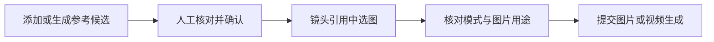

# 不同视角参考资产与分镜一致性

为人物、场景和道具准备单独的正面、侧面、背面或细节图，再按镜头需要选用。入口是**设定档案或设定节点编辑区 →「独立参考图」**。

[添加与使用](#使用流程) · [视频参考模式](#视频参考模式) · [状态版本](#基础设定与派生状态) · [同步与锁定](#版本与同步) · [常见问题](#生成与限制)

[← 使用指南](README.md) · [下一步：制作成片](basic-final-cut.md)

| 图片 | 用来做什么 |
| --- | --- |
| 信息图 | 保存对象的完整视觉设定，可包含多个视角 |
| 独立参考图 | 为特定镜头提供单一角度、身份或局部细节 |
| 分镜图 | 表达镜头构图；作为首帧提交时才用于约束视频起点 |

添加多个视角不会自动铺开更多设定节点。人物、场景、道具仍各用自己的设定档案管理。

## 使用流程

1. 打开设定档案或设定节点的「独立参考图」，点击「添加参考图」。
2. 选择视角和用途，再选择下表中的添加方式；按角度生成时，先预览、编辑提示词，再提交 1、2 或 4 张候选。
3. 核对单个对象、面部、服装、结构与画风，确认可用候选；星标可设为该视角的默认参考。
4. 打开分镜的「镜头引用」，检查自动匹配的参考图，或手动选择需要的图片及顺序。
5. 生成分镜图后，选择「首帧生成」或「多图参考」，再按所用模式检查实际图片清单。
6. 在视频参考图下调整每张图的用途，核对提示词、图片编号与参数后提交生成。

**完成后：** 确认图可供后续镜头选择，生成结果先进入候选，不会替换信息图。未确认的新候选不会自动传到下游。

### 三种添加方式

| 方式 | 操作 | 得到什么 |
| --- | --- | --- |
| 选择现有图 | 选择本项目的一张图片 | 登记为参考候选，保留原文件 |
| 裁切单张参考 | 在原图上框选单个视角，检查裁切预览 | 另存裁切候选，不放大或修复原图 |
| 按角度生成 | 选择模型、画幅、候选数量与参考依据，再预览提示词 | 生成单个对象、单一视角的候选 |

### 自动匹配怎样选图？

推荐依据是镜头文字、参考图的视角与用途、已确认的默认图，**不是图像身份识别**。

| 镜头需要 | 推荐原则 |
| --- | --- |
| 人物正面或侧面 | 独立面部身份图与对应身体视角；背面镜头不额外加面部图 |
| 人物未指定机位 | 优先默认身体图，否则选适用独立视角，不一次加入全部角度 |
| 场景全景、反打 | 优先匹配全景或反向机位 |
| 道具特写 | 优先局部细节图 |
| 没有适用独立图 | 回退使用信息图 |

手选图片及顺序会保留。只有明确点击「恢复自动匹配」后，才重新按镜头推荐；模型的参考数量限制会在预览和生成时校验，不会静默丢图。

## 视频参考模式

| 模式 | 发送什么 | 如何理解 |
| --- | --- | --- |
| 首帧生成 | 指定的首帧图片 | 以该图作为视频起点 |
| 首尾帧 | 相应首、尾关键帧 | 按所选模式约束起点与终点 |
| 多图参考 | 按视频出镜范围继承的设定引用及可选分镜图 | 分镜图默认引导整体构图，不自动成为首帧 |

也可把分镜图连接到同镜头的现有视频节点。首帧、首尾帧和多图参考遵守各自的接口限制，不能把多图用途当成严格首尾帧约束。

视频节点可为参考图指定身份、服装、空间、结构、细节、尺度、姿态、整体构图、开场、过程或结尾用途。用途只保存到当前视频节点；未绑定对象的分镜构图图可直接移除。

图片编号表示提交顺序。动作先后、运镜和收镜仍需在视频提示词中设计，开场／过程／结尾用途只提供视觉引导。

## 基础设定与派生状态

同一人物换装、受伤或战损时，显式建立状态版本，避免只凭同名或相似描述猜测身份关系。

1. 在设定编辑中选择「基础设定」，填写「服装 / 状态版本」与「本状态的差异」。
2. 先生成并确认基础信息图，再生成当前状态的信息图。
3. 核对派生图的身份、变化与画风后确认，再供镜头使用。

**生成时：** 基础图自动成为必需参考；普通补充图片连线不会建立继承关系，也不能用派生图反向生成基础图。

继承必须在同项目、同类型、同设计方案内，不能自引用或循环。「重新设计新方案」不能跨用旧方案基础档案。基础状态变化后，先核对派生参考，旧图不会自动重绘或重新确认。

## 提示词与引用编辑

| 操作 | 影响 |
| --- | --- |
| 编辑正文或设定／参考／参数／画风区块 | 只影响当前节点，不回写设定档案 |
| 来源更新与自定义内容重叠 | 显示「来源已更新」，选择保留本节点修改或跟随项目 |
| 在图片标签中添加、替换或移除参考 | 同步当前节点的实际图片输入 |
| 移除整段文字区块 | 保留实际图片连接，需分别检查 |
| 整理提示词 | 修改正文，保留当前文档区块，不从旧档案补回已删除要求 |

图片标签按素材身份保存，提交时转成「图片 N／参考图 N」。断开的引用会显示失效标签并阻止生成；保留旧编号不能恢复图片，必需基础参考不能移除。

来源冲突须先处理。比例、时长、模式及图片顺序会在提交前核验；引用的使用范围详见[镜头引用](shot-reference-usage.md)。

## 版本与同步

活动镜头默认跟随**最新已确认**的设定。图片和视频沿用同一引用快照；确认新版信息图、独立图或默认图后，后续工作引用才会更新。

| 状态或操作 | 后续行为 |
| --- | --- |
| 开启「自动跟随最新设定」 | 跟随已确认版本，保留手选图片及其顺序 |
| 关闭该开关 | 锁定当前快照，继续使用当前版本 |
| 点击「恢复自动匹配」 | 按镜头重新推荐已确认参考图 |
| 点击「使用信息图」 | 把信息图保留为人工选择 |
| 新版尚未确认或基础状态待核对 | 保留旧版并提示等待 |
| 新版与手选图不兼容 | 保留手选图及顺序，提示处理 |

同步不会修改已提交任务、历史结果或旧方案镜头，也不会重置必需标记、用途、节点排除项及手改正文。画风变化、旧修订或图片缺失时，需要核对引用。

## 生成与限制

| 常见问题 | 处理方式或范围 |
| --- | --- |
| 候选为什么不能给新镜头使用？ | 先确认，并检查设定修订、画风和图片是否仍有效 |
| 归档会破坏旧镜头吗？ | 不会；归档收起新选择，保留历史引用 |
| 任务完成了，为什么仍是旧版本？ | 结果属于提交时的设定与画风，不会自动成为新版确认图 |
| 多图参考能保证人物不变吗？ | 不能；需人工检查面部、衣物、道具、空间与动作 |
| 能自动检查三维空间或逐帧漂移吗？ | 当前没有三维场景几何计算或视频逐帧漂移识别 |

具体参考图数量、尺寸与模式能力以模型接口为准。生成、裁切与确认是不同操作；确认不会重绘图片或修复模糊细节。

实现、旧数据兼容与核对范围

### 版本与存储

参考资产保存设定修订与项目画风；镜头保存引用快照和同步设置。基础关系使用 `base_profile_id`、`state_delta`，同批草稿可用 `base_draft_key` 关联。

后端启动时补充参考资产表及镜头快照列。旧数据的独立图选择保留为手选，普通信息图引用默认跟随；不会把候选猜测为已确认视角。

### 实现入口

- [独立参考图界面](../web/src/features/visuals/VisualReferenceAssets.tsx)、[镜头引用编辑](../web/src/features/visuals/VisualBindingEditor.tsx)、[状态版本字段](../web/src/features/visuals/VisualProfileFields.tsx)
- [视觉设定存储](../backend/src/modules/visuals/visual-profiles.ts)、[参考图选择](../packages/shared/src/visuals/visual-reference-selection.ts)
- [提示词区块](../packages/shared/src/visuals/prompt-section-document.ts)、[提示词编辑器](../web/src/features/canvas/CanvasPromptEditor.tsx)

引用同步的历史文档记录日期为 2026-10-24。本次整理核对现有文档与源码，未调用真实图片／视频模型，也未验证实际生成一致性。

