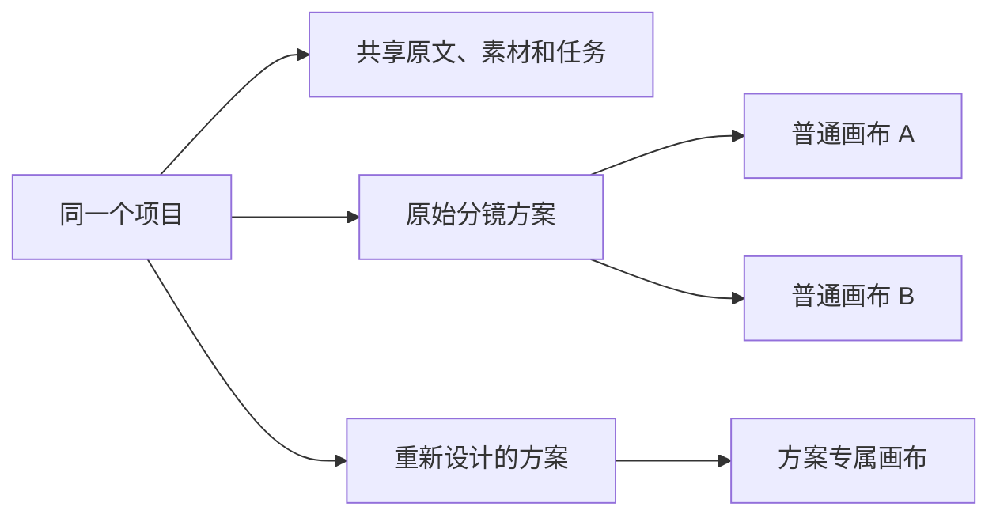

# 项目内多画布

用多张画布分开整理场次、生成素材或比较分镜方案。入口在**项目画布顶部的画布名称菜单**。

[新建和切换](#新建和切换画布) · [分镜方案](#分镜更新与历史方案) · [移动节点](#移动节点) · [成片范围](#成片与语音范围) · [常见问题](#常见问题)

[← 使用指南](README.md) · [下一步：管理分镜](shot-management.md)

## 新建和切换画布

1. 点击顶部画布名称，展开画布列表。
2. 点击列表上方的「＋」新增空白画布；新画布不会复制全部镜头。
3. 添加节点，或通过「分镜管理」把已有镜头加入这张画布。
4. 再次打开画布名称菜单，选择另一张画布；切换前会等待当前画布保存成功。

**完成后：** 各画布分别保存节点、连线、位置、尺寸、提示词、生成参数及缩放视角。菜单中的「重命名当前画布」可修改名称。

保存失败或版本冲突时，应用保留当前画布和本地草稿，不继续切换。素材库的「加入画布」使用本机最近选择的画布。

### 哪些内容共享？

| 范围 | 保存的内容 |
| --- | --- |
| 每张画布独立 | 节点、连线、布局、提示词、生成参数、视角、本地编辑草稿 |
| 同一分镜方案共享 | 镜头、视觉设定及其继承关系 |
| 整个项目共享 | 原文、全剧文档、素材库、生成任务、台词和配音候选 |

普通空白画布使用原始分镜方案；「重新设计新方案」才会创建独立镜头、设定和专属画布。画布不是一份新的项目副本。

## 分镜更新与历史方案

在「加入画布」的分镜工作台中，通过「规划方式」选择如何处理已有分镜。

| 规划方式 | 适合做什么 | 对已有内容的影响 |
| --- | --- | --- |
| 复用已保存分镜 | 把已有镜头补回画布 | 复用仍有效的镜头与设定，不重复规划已完成场次 |
| 沿用当前方案更新 | 修改当前镜头设计 | 保留已有镜头 ID，可修改或新增，不能遗漏已有镜头 |
| 重新设计新方案 | 尝试另一套镜头方案 | 新建镜头、设定和独立画布，保留旧方案与素材 |

1. 在左侧勾选本次要处理的场次。
2. 选择规划方式及所需时长，开始规划。
3. 检查返回的镜头、提示词与时长；此时只是预览。
4. 确认加入后，保存分镜并准备人物、场景、道具文字设定，再加入画布。

**注意更新影响：** 镜头内容变化或来源过期后确认更新，会取消受影响镜头的当前选片和时间线取段，并重置关联生成节点。历史素材与任务保留，旧任务结果不会自动填回新版节点。

规划只处理已勾选场次。正文、项目简介、画幅或画风变化可能使旧规划过期；保存时间、是否已加入画布和选片变化不会单独使创作来源过期。

旧方案可在其画布继续制作。若方案专属画布已经删除，规划入口会要求「重新设计新方案」，确认后创建新画布。

## 移动节点

1. 在画布中选中要移动的节点。
2. 打开画布名称菜单，选择「将所选节点移至」及目标画布。
3. 核对需要断开的跨图连线，再确认移动。

**完成后：** 节点 ID、提示词、固定参考图及镜头／素材／任务关联保持不变；所选节点之间的连线与相对位置一起移动。

连到留在原图节点的连线不能跨画布保留。目标已有同一视觉设定节点时会拒绝移动；移动会清除两张画布的撤销历史。

## 成片与语音范围

成片工作台按所选设计方案读取镜头，包含尚未摆到画布上的镜头。普通画布共享原始方案，因此方案列表会合并显示它们。

| 内容 | 范围 |
| --- | --- |
| 制作起止镜头 | 按画布保存；重新设计时保留旧画布原有范围 |
| 时间线、接镜、预览与导出 | 使用当前选择的成片范围 |
| 台词和配音候选 | 项目共享 |
| 配音入片位置与取段 | 按方案保存，同一句台词可在不同方案分别放置 |
| 配乐音量、对白时压低其他声音 | 项目共享 |

导出只包含当前方案中已放置且有效的语音。选择历史方案，可以继续剪辑旧镜头；新方案不会自动混入旧方案的视觉设定或配音放置。

## 常见问题

| 问题 | 说明 |
| --- | --- |
| 删除画布会删除素材吗？ | 默认保留项目资源和后台任务；可选清理及保护规则见[分镜管理与画布清理](shot-management.md#删除画布) |
| 为什么不能删除最后一张？ | 项目至少保留一张画布 |
| 切回后能继续撤销吗？ | 同次打开期间按画布保留；刷新页面后撤销记录重新开始 |
| 设定库与素材库数量为何不同？ | 设定库默认按当前方案显示，可切换全部方案；素材库属于整个项目 |
| 一张画布能放多少内容？ | 最多 500 个可编辑节点、1000 条连线；固定项目剧本引用节点另计，可用多张画布分散工作 |

## 存储和兼容

提示词编辑与设定节点

### 正文与折叠要求

普通图片、视频节点优先显示提示词正文；画风、参考和生成要求可展开编辑。折叠只改变显示，仍会进入实际提示词。

「复制正文」只复制普通正文；「复制完整提示词」包括要求区块与图片引用。全文替换或移除要求区块会保留图片连接，文字与实际参考图需分别核对。

「来源与修改记录」集中显示来源及待确认变动。自定义内容遇到重叠更新时需选择保留修改或跟随来源；已移除要求可明确恢复来源内容。

实际比例、清晰度和视频时长由底部生成控件决定；区块菜单的「调整生成参数」打开同一个参数面板。

### 独立创建设定图

空白处右键或「添加节点」可创建人物、场景、道具设定节点；也可右键已有图片创建并连接。节点独立于剧本规划，不会额外创建镜头或改写已有设定档案。

连线只更新提示词；点击生成才调用图片模型。使用参考图时，需要模型支持对应图片输入。设定图「整理提示词」应用后只更新当前节点，画风、参考用途及参数区块保留。

多视角图与镜头引用的用法见[参考图工作流](multi-angle-reference-workflow.md)。

存储、接口与历史验证

### 数据与兼容

`project_canvases` 保存画布名称、顺序、默认标记和视角；节点与连线按 `canvas_id` 归属。旧节点及 ID 迁入「画布 1」，不重新生成资源；迁移使用可重复执行的事务。

原 `/api/projects/:id/canvas` 继续读写默认画布。节点和连线 ID 在项目内唯一；图版本只包含该图节点和连接，其他图的编辑、改名或视角更新不会造成假冲突。

### 接口

以下路径均以 `/api/projects/:id` 开头。

| 方法与路径 | 用途 |
| --- | --- |
| `GET/POST /canvases` | 列表、新建 |
| `GET/PUT /canvases/:canvasId` | 读取、带版本保存 |
| `PATCH /canvases/:canvasId` | 名称、视角 |
| `GET /canvases/:canvasId/deletion-preview` | 删除影响与清理指纹 |
| `DELETE /canvases/:canvasId` | 带当前版本删除；可选清理另需引用指纹 |
| `POST /canvases/:canvasId/move-nodes` | 带两图版本事务移动 |

### 源码与验证边界

实现入口：[画布存储](../backend/src/modules/canvas/project-canvases.ts)、[画布切换](../web/src/features/canvas/ProjectCanvasSwitcher.tsx)、[分镜规划](../backend/src/modules/storyboard/storyboard-planning.ts)、[成片范围](../backend/src/modules/final-cut/final-cut-scope.ts)、[配音入片](../backend/src/modules/speech/speech-timeline.ts)。

初始记录基线为 2026-10-22、`9ba5a25`。2026-10-26 场次范围修复记录：相关后端测试 79/80、规划界面测试 22/22 通过；一项视觉设定年龄同步断言失败，修复前快照也可复现。

这些历史测试使用临时数据库和模拟模型。本次文档整理只核对现有文档与源码，没有重新执行迁移或真实模型生成。

