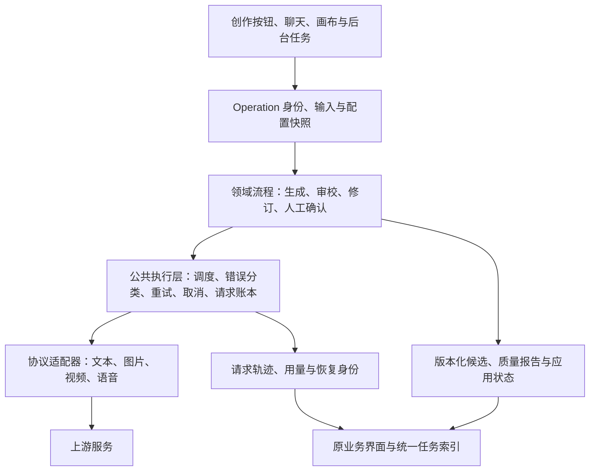

# 全项目 AI 接入与工作流可靠性分析

日期：2026-11-13。范围：当前工作区中的所有 AI 接入家族，包括模型传输、内部辅助调用、业务编排、媒体任务、前端恢复与质量验收。

## 结论与证据边界

应把所有 AI 功能纳入共同的执行、恢复、候选产物、质量与观测契约。当前主要问题是可靠性能力覆盖不均、执行错误和质量结论混用、已完成结果复用不足。换模型 SDK 或为每个接口增加重试，不能单独解决这些问题。

本轮只做分析，未修改业务实现、模型配置或正式项目数据，未发起真实 AI 请求。分析基于当前源码，不代表当前运行进程一定加载了同一份代码。起始分支为 `codex/preserved-main-workspace-20261110`，工作区有 500 项既有改动，结论不以 HEAD 代替当前文件。两个受控模拟验证见下文，其余“确认”指静态调用链确认。

静态 AST 盘点发现 `generateStructuredOutput` 有 51 处调用、分布在 33 个文件；`streamText` 有 14 处调用、分布在 7 个文件。这是调用点统计，包含内部包装/递归，不是功能数量、外部请求次数或成功率。HTTP 出口还包括原生 Gemini 看图、TTS、非流式生成、任务查询、结果下载、模型目录和输入 token 计数。内部技能选择、参考选择、证据定位和复核都应归入用户发起的同一次 operation。

现有日志没有覆盖所有入口，无法仅据本轮分析量化“全项目成功率下降多少”。截图提供了一次耗时约 67 分钟且不可交付的分镜案例；它与以下设计问题吻合，但不能用于推断所有服务商故障或实际重复计费。

## 1. 调用范围与现状

| 功能家族 | 主要代码入口 | 已有保护 | 主要增强点 |
| --- | --- | --- | --- |
| 导演聊天、工具调用、阶段生成、候选修订 | [app.ts](../../backend/src/app.ts#L1838)、[director-tasks.ts](../../backend/src/modules/script/director-tasks.ts#L155) | 服务端任务、SSE 观察、版本断点、精确补丁、循环检测、用量账本、人工确认 | 推广已有机制；补所有内部请求的 trace，验证真实模型的修订收敛 |
| 上传原文分析与全剧理解 | [script-source-analysis.ts](../../backend/src/modules/script/script-source-analysis.ts#L376) | 后台队列、页/章节/综合结果 checkpoint、暂停、语义停滞判定 | 飞行请求身份恢复、跨入口限流、每次调用观测 |
| 独立文档、完整剧本、专项讨论及回复分类 | [app.ts](../../backend/src/app.ts#L3400)、[独立文档](../../backend/src/app.ts#L3974)、[完整剧本](../../backend/src/app.ts#L3992) | 输入/模型检查，部分结构化契约，结果交创作者确认 | 一次 HTTP 的结果找回、取消、候选落盘与错误分类 |
| 技能选择、可选参考资料选择 | [model-skill-selection.ts](../../backend/src/modules/skills/model-skill-selection.ts#L99) | 真实 ID/预算检查、有界选择与无进展保护、有限进程缓存 | 计入父任务、可恢复准备结果、辅助阶段失败的明确处理 |
| 提示词精修、独立语义审校、证据定位 | [skill-routes.ts](../../backend/src/modules/skills/skill-routes.ts#L381) | 来源/参数/逐字对白校验、人工应用、HTTP 取消 | 候选与审校持久化、审校不确定/误报的处置、局部修订 |
| 失败图片提示词优化 | [prompt-optimization.ts](../../backend/src/modules/jobs/prompt-optimization.ts#L12) | 只给建议，不自动重发媒体任务 | 独立 operation、候选保存、取消与请求记录 |
| 场次分镜与片段分镜 | [storyboard-planning.ts](../../backend/src/modules/storyboard/storyboard-planning.ts#L477)、[clip-storyboard.ts](../../backend/src/modules/storyboard/clip-storyboard.ts#L150) | 场次规划有后台任务和两镜 checkpoint；严格来源/镜头/时长校验 | 场次终态锁定、局部修订；片段链路补同等持久恢复 |
| 视觉设定、参考绑定、加入画布前准备 | [visual-profiles.ts](../../backend/src/modules/visuals/visual-profiles.ts#L758)、[script-canvas-preparation.ts](../../backend/src/modules/canvas/script-canvas-preparation.ts#L94) | 来源签名、逐镜用途与引用预算、应用前确认 | 分组结果 checkpoint、取消扇出、局部失败保留成功组 |
| 画布节点方案、视频声音交接 | [canvas-node-proposals.ts](../../backend/src/modules/canvas/canvas-node-proposals.ts#L155)、[video-audio-plan.ts](../../backend/src/modules/canvas/video-audio-plan.ts#L133) | 结构化输出、来源版本保护；部分路由绑定取消 | 统一 operation、候选版本、请求 trace 与恢复 |
| 图片反推与视频反推 | [image-prompt-analysis.ts](../../backend/src/modules/canvas/image-prompt-analysis.ts#L65)、[video-prompt-analysis.ts](../../backend/src/modules/canvas/video-prompt-analysis.ts#L100) | 多模态能力检查、输入限制、取消、晚响应不覆盖手改 | 原生 Gemini 与文本看图纳入同一指标；来源变化后保留独立候选 |
| 接镜/制作连续性与视频成片复核 | [continuity/analyze](../../backend/src/app.ts#L2983)、[video-continuity-review.ts](../../backend/src/modules/canvas/video-continuity-review.ts#L96)、[video-review.ts](../../backend/src/modules/assets/video-review.ts#L122) | 来源签名、证据时间校验、复核历史、部分人工接受、声音能力边界 | 进行中的任务恢复、统一质量状态；未验证的音轨不得推定通过 |
| 图片、视频、独立参考图及对照生成 | [processJob](../../backend/src/app.ts#L2497)、[providers.ts](../../backend/src/infrastructure/providers/providers.ts#L1330)、[video-comparison.ts](../../backend/src/modules/generation/video-comparison.ts) | 队列、上游任务 ID、加密恢复 URL、未知结果禁止重发、事务完成 | 入口幂等覆盖、阶段级 trace/取消、视频产物可解码验证 |
| 配音 TTS 单句与批量 | [speech-provider.ts](../../backend/src/infrastructure/providers/speech-provider.ts#L75)、[speech-routes.ts](../../backend/src/modules/speech/speech-routes.ts) | 每次只提交一次、超时、协议检查、音频探测、历史 take | 提交身份、失败请求 ID/用量、取消与未知结果状态 |
| 画布泛型文本生成 job | [configuredNetwork](../../backend/src/infrastructure/providers/providers.ts#L1399) | 容量预检、输出截断识别、job 结果 | 此通道走 requestJson，不是 streamText；需补同等账本/指标/取消 |
| 模型目录、能力配置与输入计数 | [model-catalog.ts](../../backend/src/infrastructure/providers/model-catalog.ts#L110)、[text-request-plan.ts](../../backend/src/infrastructure/providers/text-request-plan.ts#L35) | 配置显式校验、响应/时间限制、能力作用域、估算回退 | 区分目录可达、配置合法、实际生成能力与质量验证 |

媒体渲染、图片压缩、视频抽帧等本地处理不是 AI 模型调用，但它们属于 AI operation 的准备/验证/交付阶段，耗时和失败应能定位，避免全部显示为“模型生成失败”。

## 2. 已确认的关键缺口

### A. 执行成功、产物完整、质量通过、正式应用没有统一状态

分镜在完整修订候选已经落盘后，二次复核任一 `error` 就抛异常；投影仍为 `pending_review`，同时 `can_resume=false`。前端因此锁编辑、复查与保存。这是已确认的终态缺陷，见 [finish](../../backend/src/modules/storyboard/storyboard-planning.ts#L493)、[can_resume](../../backend/src/modules/storyboard/storyboard-planning-tasks.ts#L138)、[fieldset](../../web/src/features/storyboard/StoryboardPlanner.tsx#L670)。

提示词精修也会在审校仍有 issue 或证据无法定位时直接报错；当前生成候选与中间报告没有服务端 checkpoint。`uncertain` 也作为阻断项，不能等同于已经证实正文错误，见 [semantics](../../backend/src/modules/skills/prompt-refinement-semantics.ts#L83)、[精修主链](../../backend/src/modules/skills/skill-routes.ts#L387)。

剧本候选处理已经存在待决事项、建议不阻断、有理由撤回误报等更成熟机制，可推广。质量判断仍需证据核实，不能通过简单降级所有 error 或删问题提高表面成功率。

### B. 局部缺陷触发全量重生成，增加费用并可能引入新问题

分镜修订重新执行完整 `makePlan`，生成大纲再扩写全部镜头，见 [repair](../../backend/src/modules/storyboard/storyboard-planning.ts#L485)。提示词精修通常也重新生成完整正文。相反，剧本精确补丁和原文分析已有按问题修补、复用完整单元等能力。

建议以问题 ID、候选版本和允许变更字段生成局部变更集，验证未涉及内容保持不变，再检查受影响的邻接/全局约束。确有全局依赖时扩大范围，并记录理由；不能强行把所有改动限制成单镜。

### C. 通用校验会把业务冲突误当成可付费格式修正——已模拟复现

[model-output.ts:268](../../backend/src/modules/generation/model-output.ts#L268) 捕获 `validate` 的所有异常，随后请求一次格式修正；二次失败统一报 422。资料版本变化、运行异常或取消不一定是模型能修正的问题。

本轮用纯内存 fake generator 返回合法 `{value: "fixture"}`，在 validator 抛 `statusCode=409`。实际得到 `fake_model_calls=2`、最终 `statusCode=422`。无真实网络和计费。分镜批次校验中包含 `checkCurrent`，具备走入该路径的条件，见 [validateBatch](../../backend/src/modules/storyboard/storyboard-planning.ts#L431)。

应让不可由模型修正的错误原样传播；仅对显式契约/可纠正内容问题执行 correction，保留原始类别、阶段与恢复动作。

### D. 视频“下载成功”可以被误记为“生成成功”——已模拟复现

[download](../../backend/src/infrastructure/providers/providers.ts#L925) 只检查 HTTP、大小和非空。图片路径通过 sharp 验证，视频路径直接返回 `.mp4` 文件；[processJob](../../backend/src/app.ts#L2554) 随后可记成功。

媒体子审计在隔离临时目录 mock 下载返回 HTTP 200、`Content-Type: text/html`、HTML 正文，`recoverVideo` 仍成功保存 `.mp4`，内容原样是 HTML。该实验只验证恢复下载函数；没有向正式数据库插入成功 job。

需验证媒体可解码、存在视频流和合理时长，再入库成功。下载失败、结果内容无效、创意质量不符是不同类别；无效下载应保留原上游 ID/URL，不能自动新建生成。

### E. 阶段 checkpoint 不等于上游请求恢复；身份覆盖存在空缺

导演任务通过 [withTextResponseRecovery](../../backend/src/modules/script/director-tasks.ts#L166) 保存 Responses 身份；只有配置 `background_responses=true`、协议支持、结构化任务且存在该 scope 才启用，见 [providers.ts:739](../../backend/src/infrastructure/providers/providers.ts#L739)。普通流式请求不能因此宣称均可续接上游。

独立原文分析有完整阶段 checkpoint，却未绑定该 scope；[recover](../../backend/src/modules/script/script-source-analysis.ts#L532) 会把旧 running 自动转 queued 再运行。若崩溃发生在上游受理后、本地当前步骤落盘前，会再次执行该步骤。路径确认存在，是否实际双计费未验证。

媒体已有较强保护：先保存尝试/任务 ID/结果 URL，不明确的结果禁止盲目 POST。应扩展这一语义，同时细分“准备中尚未发出”和“已经开始派发、是否受理未知”，避免本地预处理失败也要求用户核对厂商。

短文本、片段分镜、精修、反推、视觉整理缺少同等 operation/result 查询路径。服务端结果先落候选再通知 UI，能减少响应丢失后的重复生成。

### F. 部分并行任务会丢失已成功兄弟结果

画布准备 [Promise.all](../../backend/src/modules/canvas/script-canvas-preparation.ts#L94) 中某组失败会使整体请求失败；其余已启动请求未必停止，已成功组没有对应 durable draft checkpoint。视觉整理的生成接口本身未传入入口级 signal，见 [visual-profiles.ts](../../backend/src/modules/visuals/visual-profiles.ts#L758)。

剧本依赖任务已有先等待已启动兄弟结束并落盘、再报告失败的策略，可复用。应统一分组结果持久化、取消扇出和部分成功交付；使用 allSettled 本身不够，仍需明确保存与取消政策。

### G. 没有覆盖所有出口的共同请求记录、调度与错误契约

底层 `TextRequestMetrics` 已包含首事件时间、token、HTTP、上游 request ID，但 callbacks 是可选的。导演 [tracedDirectorRequest](../../backend/src/app.ts#L2154) 连接了记录；通用 [creativeText](../../backend/src/app.ts#L2605) 没有同等记录，projectId 未参与追踪。Gemini 看图、TTS、媒体查询/下载、非流式文本 job 又有独立路径。

[结构化生成](../../backend/src/modules/generation/model-output.ts#L218) 还通过契约名称前缀和名单决定只读网络重试。相同性质的精修/视觉/视频复核不会因共享函数就自动具有同等重试。应显式声明请求是否允许安全重试、任务用途和副作用，而非以名字承载政策。

[媒体 job 队列](../../backend/src/modules/jobs/job-queue.ts#L39) 有数据库原子认领与总并发，原文分析有自身并发，但不是所有提供商调用共用的调度器。未发现覆盖所有入口的 provider/model 级并发、429 退避协同和熔断；不能把局部并发称为全局治理。

通用前端 [ApiError](../../web/src/shared/api/api.ts#L3) 仅保留 status/raw_output/diagnostics，机器 code、结果确定性、task/trace ID 与恢复动作未统一传递。[任务中心](../../web/src/features/jobs/task-records.ts#L34) 只消费 `detail.jobs`，不能代表全部 AI 工作。

### H. 语义审校的证据处置能力不一致

精修证据定位要求维持原结论，无法定位就失败，见 [prompt-refinement-evidence.ts](../../backend/src/modules/skills/prompt-refinement-evidence.ts#L74)。剧本已有逐项、有理由的 confirmed/withdrawn/unresolved，见 [script-draft-evidence-reassessment.ts](../../backend/src/modules/script/script-draft-evidence-reassessment.ts#L58)。分镜 validator 主要检查引用镜头是否真实/相邻，不能证明语义结论成立，见 [storyboard-directing.ts](../../backend/src/modules/storyboard/storyboard-directing.ts#L136)。

应统一“问题→定位证据→复核结论→处置”，保留 unresolved；不能仅因 JSON 合法或引文存在就宣布审校正确。需要区分事实矛盾、来源漂移、不可执行动作，与创作口味/节奏建议。

### I. 页面关闭、取消请求、上游停止和停止计费不是同一件事

导演与场次分镜有服务端取消；一些小工具只 abort HTTP，部分后端能向模型传播 signal，部分没有；媒体 `generate`/查询/下载和 TTS 没有统一外部 signal。不能仅凭前端提示“已取消”断定厂商已停止。

统一表达：停止观察、请求停止、已停止本地派发、上游取消已确认、上游结果未知。取消后保存已有成果，未确认结果不能自动新建付费任务。供应商不支持取消时应准确呈现能力边界。

### J. 付费入口幂等覆盖不全，输入签名不能替代提交身份

主生成接口和画布已有持久提交身份；独立参考图 [reference-generate](../../backend/src/modules/visuals/visual-reference-assets.ts#L252) 则每次创建新的 UUID jobs，见 [回调](../../backend/src/app.ts#L2679)。相同输入签名用于判断来源一致，不能识别“新生成”和“旧提交响应丢失后的重放”。

TTS 单句依赖 queued/running busy 检查，有意再次生成是合法的，但成功后重放也会创建新 take，见 [入队](../../backend/src/modules/speech/speech-routes.ts#L104)。应使用持久 operation/submission identity 区分重放与新意图，保留用户生成多候选的能力。当前静态路径确认，未在真实服务重复提交或核对账单。

### K. 媒体恢复还缺本地成果接管与过期链接刷新

当前恢复主要识别上游 task ID 和结果 URL。若文件已经完整保存、数据库事务尚未提交时进程退出，缺少可接管本地成果的 `result_staged` 记录；同步图片 Base64 与 TTS 无 URL 时尤其难恢复，不能据此自动重新生成。见 [本地写入与提交边界](../../backend/src/app.ts#L2518)。

已保存 URL 的恢复优先于 task 查询，过期 URL 会反复下载失败；即使保留了上游任务 ID，当前也没有标准的“只读查询刷新链接”动作。需在提供商支持时刷新同一已完成任务的结果链接，或明确不可恢复，避免形成只剩重付费的路径。新增恢复仍须保留“未知受理不盲目 POST”。

### L. 扩展并发前需要区分执行槽、上游等待和任务所有权

图片/视频等待轮询最长 30 分钟时持续占用 job running 槽；TTS、生成、导出又共享池。应分离短时提交/查询/下载的资源与异步等待，并建立公平调度，避免长等待占满其他工作容量，见 [队列](../../backend/src/modules/jobs/job-queue.ts#L39)。

队列正常 claim 有 SQLite immediate/CAS 保护，但 [启动恢复](../../backend/src/infrastructure/database/db.ts#L989) 会把全部 running 视作旧进程遗留，没有 owner/lease；第二服务实例若在第一实例仍运行时启动，可能接管活任务。该风险取决于部署拓扑，当前是否触发未验证。多实例扩展需租约、失效接管与完成 fence，不能只换框架。

媒体 JSON 响应先完整 text 缓冲再检查，预处理也可能并行解码多张图片；下载本身已有流式大小上限。后续要补响应/预处理资源限制与压力验证，不能把全局 job 并发当作完整内存控制。

## 3. 应保留的现有能力与明确政策

- 已有 Responses/Chat Completions/Anthropic 与媒体自定义适配、结构化契约、上下文预检、截断识别、只读重试和工具副作用隔离，不能迁移后退化。
- 导演与原文分析已有语义进展检测、A→B→A 防循环、精确补丁、版本 checkpoint；不是完全没有循环保护。
- 当前剧本创作和上传分析明确采用不限应用层累计请求、token、修订轮数、业务时长的政策。execution/proposal 的“budget”现为记账，不是强制限额，见 [script-execution-usage.ts](../../backend/src/modules/script/script-execution-usage.ts#L11)、[当前说明](../script-analysis-cost-control.md)。本建议不暗中恢复固定轮数/总时限；优先统一用量、无进展判停、阶段告知、取消和按任务显式选择的预算政策。
- 图像/视频已有未知提交不重发、任务号/加密结果链接、恢复不读原参考文件、事务入库；画布有 IndexedDB 提交账本、Web Locks 和 lookup。
- TTS 已有单次请求、音频实际探测和历史 take；成片复核明确标记未验证声音/口型，不能被统一框架抹掉。
- 创作者确认、模型配置、推理设置、提供商映射与来源版本保持显式。模型切换/质量降级不能作为静默故障回退。

## 4. 统一增强目标

### 4.1 公共执行内核与领域编排分工

所有 AI HTTP 出口均必须经过公共执行记录；长流程采用持久 task/step，短流程也有 operation ID 和可查询结果。统一的是执行契约，领域提示词、来源规则、媒体恢复协议和业务结果继续由各模块负责。

初期用索引关联现有导演、分析、分镜、jobs 和 speech_takes，保留其领域存储。迁移时只选一个状态所有者；不能同时让旧 checkpoint 和新图状态各自决定恢复与付费派发。

### 4.2 四轴状态

| 维度 | 建议状态 | 作用 |
| --- | --- | --- |
| 执行 | queued / running / cancelling / cancelled / interrupted / failed / completed | 自动处理进行到哪里、是否还能运行 |
| 产物 | completeness: none / partial / complete；freshness: current / stale | 完整程度与来源新鲜度分别记录；部分产物也可能过期 |
| 质量 | not_reviewed / reviewing / passed / needs_work / inconclusive | 审校结论及其确定性，不伪装成传输失败 |
| 应用 | private_draft / creator_confirmed / applied | 保存草稿、确认采用、正式生产分别控制 |

完整候选有质量问题时，允许结束自动处理并保留可编辑草稿。保存私人草稿不等于允许违反生产硬约束。来源冲突的结果可单独查看比对，不能直接覆盖当前内容。半截 JSON/不完整工具参数仍只能保留为诊断，不能作为已验证业务结果。

### 4.3 每个请求的必要信息与行为

- 身份：operation/task/logical_step/attempt、来源/候选版本、模型和提供商配置快照、技能/参考版本、prompt/schema 版本；外部 request/response/task ID 单独记录。
- 阶段：本地准备、等待调度、开始派发、上游受理、首事件、首正文、完成、解析、审校、落库。心跳只能证明本地任务活着，不能冒充上游进展。
- 结果确定性：未派发 / 是否受理未知 / 已受理 / 已完成；受理未知时不自动重发不具幂等能力的操作。没有上游幂等/查询能力时，不承诺端到端 exactly-once。
- 错误：鉴权、配置、容量、限流、传输、拒绝、输出截断、契约、来源冲突、质量未决、无进展、未知结果、下载/解码/入库分别分类。
- 策略：一个位置负责自动网络重试，尊重 Retry-After、退避与抖动；格式修正、内容修订、传输重试分别计数。工具和媒体副作用不会因外层重试再次执行。
- 调度：provider/model 级并发与速率协调、排队/背压、异常通道熔断与探测恢复；不同任务共享治理，保留已有 job 的原子认领。跨进程扩展另需租约/所有权。
- 用量：实际、估算和待核对分开；内部技能/审校/证据调用计入父任务；相同请求恢复不重复结算；请求容量与多轮累计费用分别统计。
- 数据：默认保留排障所需元数据；prompt/候选快照按项目需求受控保存，密钥、授权头、签名 URL、Base64 媒体不进入外部 trace。不能上传模型隐藏推理。

### 4.4 质量修订需要明确收敛

先依据已核实问题做最小修订，保留正确内容；复核只改变本轮需要改变的内容，必要的全文约束继续检查。每轮记录已解决、仍存在、新引入、审校撤回和未决的问题。重复候选/重复问题/来回回退判为停滞，返回可处理草稿和理由；无需用户为系统内部同一授权反复确认。

不能保证真实模型必然收敛。缓慢变化的新问题是否实际上有价值，需要真实样本评测与人工判断；不以“轮数还在增加”或“诊断换了说法”当作进展。

## 5. LangChain、LangGraph、LangSmith 如何使用

| 选项 | 适用范围 | 当前建议 | 仍需项目负责 |
| --- | --- | --- | --- |
| LangSmith | 请求树、耗时/错误定位、版本实验、真实失败形成评测集 | 优先接入，可独立用于现有代码；公共出口默认记录，覆盖内部调用与非文本操作 | 业务状态、候选、幂等、取消、真实质量标准 |
| LangGraph | 长任务状态、条件分支、checkpoint、人工介入与恢复 | 用一条复杂流程验证后逐步推广；现有模型调用与业务验证可作为节点 | checkpoint 存储/运行设施、状态迁移、调度所有权、外部副作用和来源版本 |
| LangChain | 常见文本模型/工具接口与 provider 集成 | 按可替换代码与维护收益采用；不要求所有短按钮转 agent，不全量包装媒体异步接口 | 第三方网关差异、自定义图/视频协议、业务质量与恢复政策 |

LangGraph 可以独立使用；LangSmith 不要求 LangChain。图重放可能重新运行节点及外部调用；持久 checkpoint 本身不保证供应商调用仅一次。应明确节点粒度、持久化方式与副作用隔离，再做进程退出实验。

参考本会话已读取的官方文档：[LangChain](https://docs.langchain.com/oss/javascript/langchain/overview)、[LangGraph](https://docs.langchain.com/oss/javascript/langgraph/overview)、[Checkpointers](https://docs.langchain.com/oss/javascript/langgraph/checkpointers)、[LangSmith 自定义埋点](https://docs.langchain.com/langsmith/annotate-code)、[Evaluation](https://docs.langchain.com/langsmith/evaluation)。本轮没有安装依赖、建立账号或发送 trace。

## 6. 实施优先级与验收建议

| 顺序 | 工作包 | 完成标准 |
| --- | --- | --- |
| 第一批：避免成果被锁和错误返工 | 修正终态；传播非模型可修正错误；视频解码验证；短操作结果先落候选；统一机器错误/恢复动作 | 审校未通过仍可编辑/复查；409 不请求格式修正；HTML 不成为视频成功；已接受操作响应丢失能找回 |
| 第二批：全部出口接公共执行层 | operation/attempt 账本、统一 trace、短/长任务身份、取消、provider 调度、能力与输入快照 | 所有 AI 派发有父 operation 和请求记录；重试原因可解释；429 不由各页面独立形成重试风暴 |
| 第三批：逐家族统一恢复与局部修订 | 导演/原文分析→分镜/精修→视觉/画布准备→反推/复核→媒体/TTS 的差异逐项补齐；用长流程验证 LangGraph | 页面刷新/断网/重启可找回结果；只做未完成步骤；并行失败保留成功组；未知受理不盲目 POST |
| 第四批：真实评测与持续回归 | 固定真实业务集、失败注入、供应商契约样本、质量实验和版本对比 | 分功能衡量真实可用候选与人工采用；比较总耗时/费用与局部修订净收益，不只统计 HTTP 200 |

第二批开始于第一批期间即可，尤其 trace 与错误契约应为后续改造提供观测。所有入口先纳入清单和共同最小契约，复杂编排逐步迁移，避免一次覆盖整个仓库但缺少可验证结果。

最低故障验收集：

1. 上游已受理但启动响应丢失；客户端重开、同标签重试、两标签同时提交时沿用同一 operation identity，只找回原操作；用户显式创建新身份仍可再次生成相同输入。
2. 上游 429/502、鉴权失败、内容拒绝、慢首包、长推理、流中断、输出截断；分类与恢复不同。
3. 首次生成后复核断流、修订后仍有质量问题、无法定位证据；候选/已完成报告可找回，不锁死人工修复。
4. 服务退出在派发前、受理后、ID 落盘后、下载后、事务完成前；验证不同确定性状态下的恢复，记录无法避免的窗口。
5. 并行 A 成功/B 失败/C 进行中；成功结果持久化，取消政策明确，不重复整个组。
6. 用户在调用中修改来源/正文/模型；旧响应不覆盖新稿，旧候选可查看，来源冲突不引发格式重试。
7. 下载 HTTP 200 返回 HTML/损坏视频/空文件；不可记生成成功，原上游结果可继续核对或恢复下载。
8. 上游不支持取消或恢复；UI 显示真实状态，不承诺已停止或未计费。

验收指标需要分开记录：传输成功率、完整有效候选率、审校未决率、人工采用率、用户目标完成率、恢复复用率、疑似重复付费请求、每次 operation 请求数/费用、P50/P95 完成耗时、每轮净解决率。按任务/模型/渠道/版本分组；先建立基线再确定数值目标，本轮不编造成功率或固定加速倍数。

## 7. 尚未验证

- 当前真实模型/渠道各自的失败率、延迟分布、重复计费和后台恢复能力；本轮没有查询供应商账单或运行真实调用。
- 截图中最后一镜的语义缺陷是否准确；需对照完整候选和来源，不以审校器长文本直接作为证明。
- 未运行全量测试、浏览器验收、迁移或部署。已有模拟回归可作为实施时的起点，不能代替真实长稿与媒体成功验收。
- 新框架是否能降低维护成本，需要完整试点后依据实现复杂度、恢复正确性、业务结果和真实成本对比。
