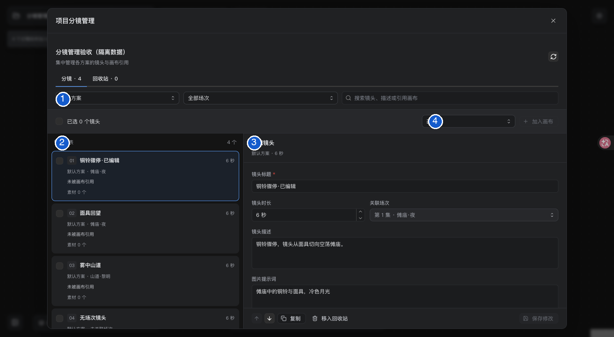
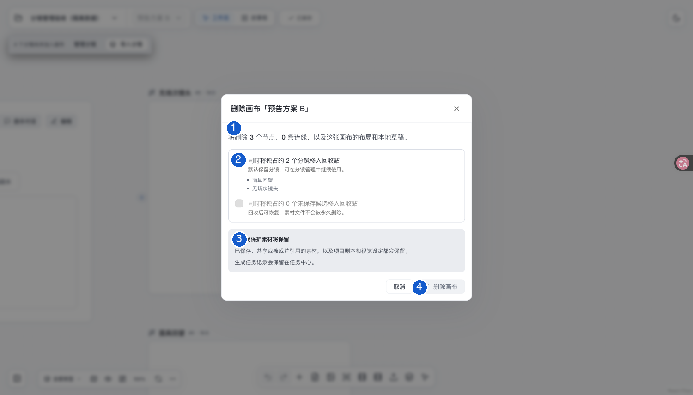

# 分镜管理与画布清理

集中编辑、排序和复制镜头，把已有镜头加入画布，或清理不用的画布与候选。入口是**画布顶部项目菜单 →「分镜管理」**。

[编辑与加入画布](#管理分镜) · [修改的影响](#修改会影响什么) · [回收与恢复](#回收与恢复) · [删除画布](#删除画布) · [常见问题](#常见问题)

[← 使用指南](README.md) · [画布与方案的区别](project-canvases.md)

## 先认识界面

图中 1 筛选方案与场次，2 选择镜头，3 编辑详情，4 将勾选镜头加入目标画布。截图为 2026-11-01 的隔离验收项目，编号为文档标注。

## 管理分镜

1. 从顶部项目菜单打开「分镜管理」；也可点击「N 个分镜尚未加入画布」旁的「管理分镜」。
2. 选择方案与场次，或搜索镜头。默认查看当前画布的方案，可切换「全部方案」。
3. 选择一个镜头，在详情中修改标题、时长、描述、提示词、起止状态或剪辑备注，点击「保存修改」。
4. 需要批量加入画布时，勾选镜头、选择目标画布，再点击「加入画布」。有未保存修改时须先保存。

**完成后：** 镜头列表会显示所属方案、场次、引用画布与关联素材数量。重复加入同一画布会复用已有镜头节点。

切换镜头、筛选条件或关闭窗口前，若有未保存内容，应用会要求确认放弃。达到目标画布容量上限时，整次导入停止并提示，不会只导入部分镜头。

## 修改会影响什么

| 操作 | 对已有制作内容的影响 |
| --- | --- |
| 修改描述、图片／视频提示词、时长、起止状态 | 需要重新制作；取消当前选片和时间线引用，保留历史素材与任务 |
| 仅修改标题、剪辑备注 | 保留已有选片与生成结果 |
| 上移、下移 | 只调整同方案、同场次内的顺序，不能颠倒已有制作范围 |
| 复制 | 创建独立镜头，继承文字与视觉绑定，不继承任务、素材或成片选片 |

整批重新规划与另建方案的区别见[分镜更新与历史方案](project-canvases.md#分镜更新与历史方案)。

## 回收与恢复

1. 在「分镜管理」中选择镜头，查看详情列出的回收限制。
2. 解除仍在使用的引用后，将可回收镜头移入回收站。
3. 需要找回时，切换「回收站」，恢复对应镜头或候选素材。

**回收后：** 常规镜头列表和生成流程不再读取该镜头，素材文件与任务记录保留。

**恢复后：** 记录恢复可用；已删除的画布和节点不会自动重建。可再从管理页将镜头加入目标画布。

| 常见阻止原因 | 需要先处理的内容 |
| --- | --- |
| 仍在画布中使用 | 移除相应节点 |
| 已选入成片或绑定配音 | 取消选片、时间线或配音放置 |
| 是制作范围起止镜头 | 调整制作范围 |
| 仍有排队或运行中的任务 | 等待或处理对应任务 |
| 已被剪辑稿、导出记录引用 | 根据详情保留该镜头，避免破坏历史记录 |

## 删除画布

删除前先看四个区域：1 影响数量，2 可选回收项，3 会保留的内容，4 最终确认。截图中的数量仅为历史测试项目示例。

1. 在画布名称菜单选择「删除当前画布」。应用先保存画布，再检查删除影响。
2. 查看弹窗中的节点、连线、独占分镜、未保存候选和受保护素材数量。
3. 按需要勾选是否把独占分镜或独占的未保存候选同时移入回收站。
4. 确认影响后点击「删除画布」。项目至少保留一张画布。

| 删除选择 | 结果 |
| --- | --- |
| 默认，不勾选清理项 | 仅删除这张画布、节点、连线、布局与本地草稿 |
| 同时回收独占分镜 | 可回收的独占镜头进入回收站 |
| 同时回收独占未保存候选 | 可回收的候选进入回收站，文件不永久删除 |
| 受到保护的内容 | 上传、导出、已保存、共享及被设定、配音或成片引用的素材保留；项目剧本和任务记录保留 |

确认前若画布或引用关系发生变化，删除会停止并刷新影响范围，清空清理勾选。请根据新范围重新选择并确认。

## 常见问题

| 问题 | 说明 |
| --- | --- |
| 删除节点等于删除镜头吗？ | 不等于。镜头仍可在「分镜管理」中找到并重新加入 |
| 删除画布会停止后台生成吗？ | 不会；任务及记录保留 |
| 为什么看不到旧方案镜头？ | 默认按当前方案筛选，切换「全部方案」再搜索 |
| 为什么提示重新读取版本？ | 镜头或引用已变化，先刷新资料，再按最新影响操作 |

## 接口

开发接口与数据兼容

以下路径均以 `/api/projects/:id` 开头。

| 方法与路径 | 用途 |
| --- | --- |
| `GET /shot-management` | 读取镜头、方案、场次、画布引用与回收站快照 |
| `POST /shot-management/actions` | 携带快照 `revision` 编辑、排序、复制、回收或恢复 |
| `GET /canvases/:canvasId/deletion-preview` | 读取删除影响与引用指纹 |
| `DELETE /canvases/:canvasId` | 携带画布 `revision` 删除；可选清理另需 `cleanup_revision` 和清理开关 |

数据库使用可空的 `shots.deleted_at` 和 `assets.deleted_at` 标记回收状态，旧数据默认可用。旧调用不提供清理开关时，仍按仅删除画布处理。

实现入口：[分镜管理界面](../web/src/features/storyboard/ShotManager.tsx)、[分镜操作与引用保护](../backend/src/modules/storyboard/shot-management.ts)、[画布删除界面](../web/src/features/canvas/CanvasDeletionDialog.tsx)。

本次文档整理核对了操作标签与代码，没有执行真实项目清理或生成。

