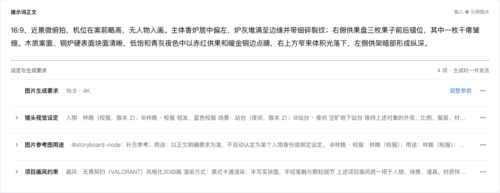

# 提示词要求清单优化验收

## 结果

截图中的四个重复卡片改为紧凑清单：标题、行内摘要、必要状态与单一操作菜单。正常的来源状态不重复展示，来源说明和内容对比放在菜单中，来源更新的决定仍直接可见。逐项展开可编辑原文，移除可撤销。

普通图片、视频和设定图的参数入口共用现有底部参数面板。比例、清晰度、视频时长、跟随源画幅及样片状态同步显示；高级参数原文仍可从菜单展开。设定图正文取消 80ch 限宽。窄编辑区摘要换行，深浅主题沿用现有配色。

## 自动验证

- `cd web && node --import tsx --test test/canvas-prompt-editor.test.tsx`：71/71 通过。包含折叠内容复制、全选替换/删除、撤销、引用、来源快照、只读模式和新普通图片清单行为。
- `cd web && node --import tsx --test --test-name-pattern='parameter shortcut shares|Seedance 2.5 canvas submits source aspect|Seedance 2.5 edit canvas' test/canvas-video-reference-integration.test.tsx`：4/4 通过。包含设定图和普通图片入口共用面板、修改保存和重挂载，以及普通视频的源画幅/样片/原视频时长摘要。
- `npm run check`：架构与 UI 组件检查通过。
- `npm run build --workspace=web`：TypeScript 和 Vite 构建通过，保留现有大体积 bundle 提示。
- `git diff --check`：通过。

## 浏览器验证

使用 TaskSpace 17 和真实 `ProjectCanvas` 组件，HTTP 全部由临时页面隔离模拟。没有生成请求，没有项目数据库写入，没有新增服务。

- 宽编辑区：四项全部默认折叠，每项约 49px，长中文摘要省略显示，来源和常态文字不重复占行。
- 调整参数：从要求行打开唯一底部弹层；切换为 9:16、2K 后，两处摘要同步，无新增参数冲突。
- 菜单：来源说明、与来源的内容对比可用；比较结果与来源一致。
- 编辑：展开画风原文、输入文字、撤销及重新折叠正常。
- 删除：单项移除后撤销、全选删除后撤销均恢复完整编辑器 JSON，包含来源信息。
- 560px 窗口：编辑区约 482px，摘要换第二行，无横向溢出。
- 设定图：主区域约 1066px，正文约 1042px，不再受 80ch 限宽。
- 深色与浅色截图均已检查。

临时验收页面已删除，TaskSpace 17 已关闭。此次验证未调用真实模型或创建生成任务，不代表整仓测试或线上环境验收。
