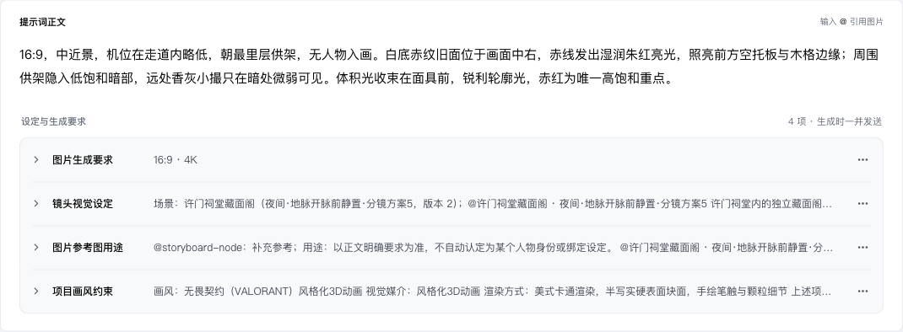

# 提示词编辑器统一样式验收

普通图片、视频和设定图的要求行共用箭头、标题列、摘要、展开编辑与菜单。图片生成要求不再单独显示行内参数按钮，参数调整进入该行菜单，继续打开底部同一个面板。相邻要求显示为一个浅底分组，分割线内缩；分组装饰保留原有段落、空白、来源、引用和撤销历史。

设定图内容承担该节点主正文的作用，可以独立整理、预览和生成。追加文字明确标为「补充说明」，可留空。它使用完整多行输入外观，焦点只强调边框，移除原先的蓝底与左侧竖线。占位文字不再重复引用提示；多个段落连接为一个输入区。

## 验证

- `cd web && node --import tsx --test test/canvas-prompt-editor.test.tsx`：71/71 通过，覆盖原文展开、折叠参数入口、只读、完整复制/删除/撤销与来源身份。
- `cd web && node --import tsx --test --test-name-pattern='parameter shortcut shares|Seedance 2.5 canvas submits source aspect|Seedance 2.5 edit canvas' test/canvas-video-reference-integration.test.tsx`：4/4 通过，覆盖普通图片、设定图与视频的共享面板及摘要。
- `npm run check`、`npm run build --workspace=web`、`git diff --check`：通过；Vite 仍有现有大包提示。
- TaskSpace 18 使用真实 `ProjectCanvas`、真实富文本编辑器及模拟 HTTP：宽屏四项均为 52px、相同的两个操作入口；生成要求可直接展开原文；菜单参数入口只打开一个共享面板。
- 补充说明粘贴两行后首尾圆角正确，撤销恢复完整编辑器 JSON。空补充区高 76px，无整块蓝色背景。
- 560px 窗口无编辑区横向溢出，摘要自动换行。截图已人工查看。

没有调用生成接口或写入项目数据库。临时验收页面已删除，TaskSpace 18 已关闭。验证范围为相关组件和交互，不代表整仓测试或真实模型生成验收。
