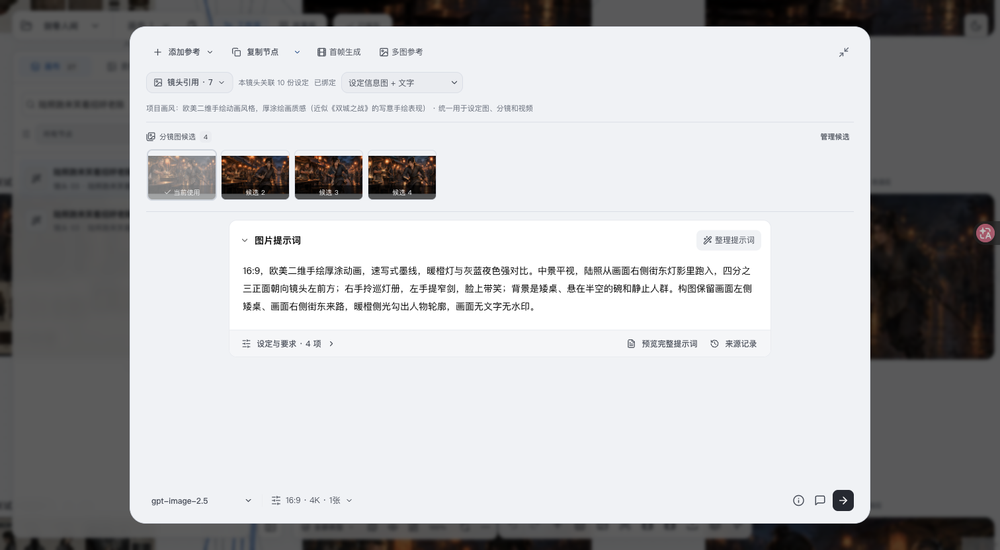
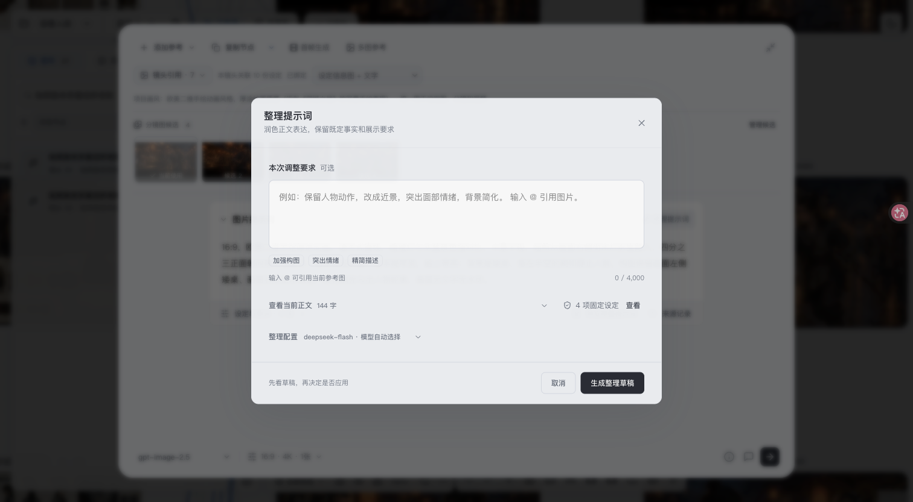
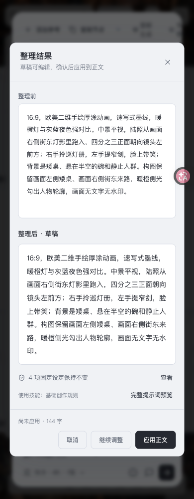
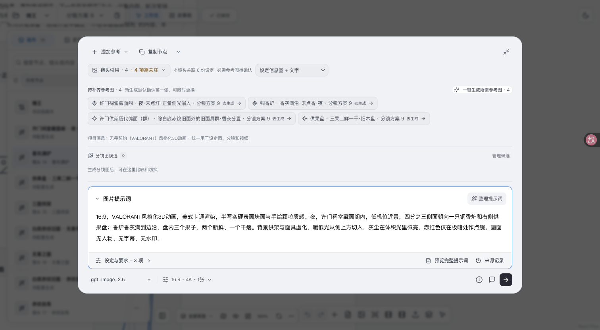
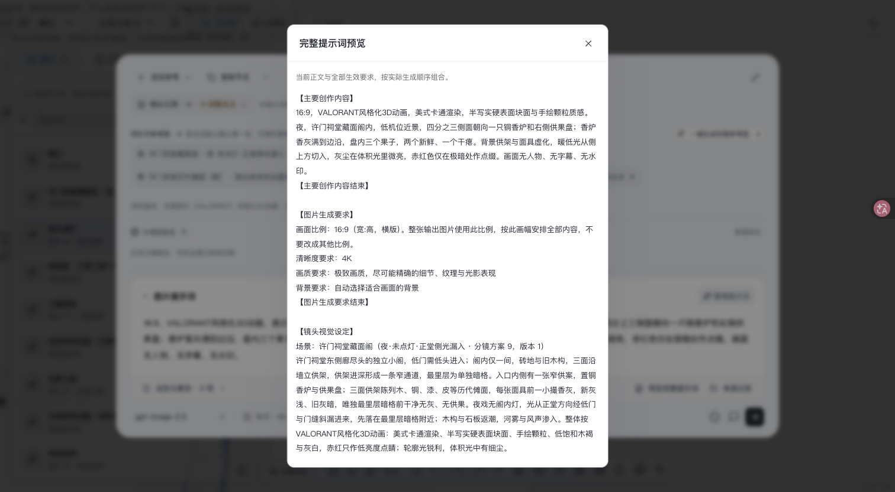
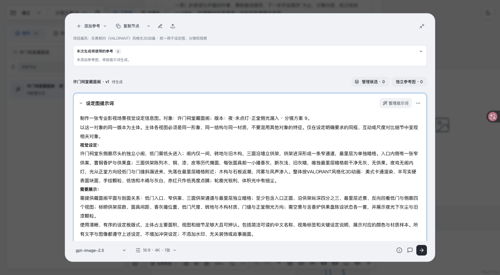

# 提示词层级与排版验收

日期：2026-11-03。按用户选中的「舒展正文」原型实施。

## 改动范围

- 图片、视频、设定图提示词使用一个正文面板，移除重复的外部标题；放大编辑最大正文宽度 820px，正文 14px、行高 1.95。
- 设定与要求、完整提示词预览、来源记录收为正文下方辅助入口，生成参数仍使用原生成底栏。
- 支持既有 11 类要求，按当前节点显示生效项；设定图的主要描述作为正文，不重复列入固定要求。
- 来源记录改为独立窗口，保留来源决策、已移除区块恢复和差异对比；关闭差异后返回来源记录。
- 整理继续使用独立弹窗，初始/继续态 680px，结果/完整预览 920px。输入、正文对照优先，配置和固定要求次级呈现。
- 整理边界仍是「可润色表达，但不能改变既定事实和展示要求」；独立固定区块不参与整理写回。不改变文档、引用、撤销和生成参数的数据契约。

## 当前检查

- 根目录 `npm run build` 通过（含架构检查、Mantine 检查、TypeScript 与 Vite）。保留已有大 chunk 提示。
- Editor / requirements / toolbar：109/109 通过。
- 来源记录：6/6 通过。
- 整理交互：10/10 通过。
- 视频参考、图片分析、设定继承、视觉模板四组集成：124/124 通过。
- `git diff --check` 通过。

## 实际页面验收

使用 Ego TaskSpace 31，结束时已 finish 一次。现有节点样本：

- 「天门烬」→「S01｜天门吞山｜生成6秒·入片6秒」：长正文单层滚动、正文宽 820px、原生成底栏保持可用，固定要求/完整预览/来源窗口独立打开和关闭。
- 「剑骨人间」→「照水门窄剑 · 鞘装」：设定图正文单独呈现，已自定义状态与来源保留；差异关闭后回到来源窗口，焦点回到关闭按钮，创作区继续保留。
- 「剑骨人间」→「陆照跑来笑着招呼老陈」：普通图片只显示一个正文标题，4 项生效要求收于辅助底栏。
- 390px 实测：页面 scrollWidth 与 viewport 均为 390；正文、来源与整理弹窗无横向溢出；结果对照纵向排列；继续调整显示独立表单。

草稿结果视觉验收仅在浏览器拦截整理接口，原样返回本地请求中的提示词。确认结果为 920px、窄屏对照纵向排列，继续调整后取消；没有点击应用，没有访问付费模型或媒体生成。拦截已移除，真实项目提示词未写回。写回、取消、过期与固定区块保护由上面的自动化测试覆盖。本次不将模拟结果作为模型润色质量证明。

未新增临时服务；保留原 8888 / 8000 服务。本次没有提交或推送。

## 截图

正文与辅助底栏：

独立整理输入：

窄屏草稿对照（本地模拟响应，未应用）：

## 截图反馈修正

用户随后指出：设定图获得焦点后背景消失、普通正文预览缺少起止标记、放大编辑区两侧和底部空白过多。本节结果取代上面的 820px 宽度设计。

- 旧设定图透明背景规则限定在非 unified 布局，unified 面板在获得焦点后继续使用同一主题背景。
- 两处完整预览共用只读展示 helper，普通正文显示 `【主要创作内容】` / `【主要创作内容结束】`。原有设定图及其他要求标记保留，不重复包裹。持久化、复制、生成请求和整理写回仍使用原提示词。
- 移除正文 820px 上限，使用创作区可用宽度。放大窗口随内容确定高度，以原高度作为上限；长内容继续由创作区统一滚动。

验证：`npm run build` 与 `git diff --check` 通过；预览 helper 3项、编辑器不改文档/复制/undo 回归1项、整理交互10项通过。构建保留原有大 chunk 提示。

Ego TaskSpace 32 使用截图对应的「傩王」→「分镜方案 9」实测，已结束：

- 「许门祠堂藏面阁」获得焦点前后均为白色，正文宽 1070px；设定图原有起止标记各一处，TipTap 无内部滚动。
- 「香灰满炉」正文起止标记各一处，图片生成要求原有标记各一处。查看预览、点击正文后，编辑内容未变化。
- 同一节点正文与可用区域左对齐，底栏与生成参数区相距12px，窗口高度约649px，短内容不再被固定高度撑开。
- 390px 下 body scrollWidth 为390px，正文无横向溢出；滚动到底后辅助底栏完整位于可见区域，生成参数仍固定。
- 深色主题聚焦前后背景均为 `rgb(27, 28, 30)`，检查后恢复浅色主题。

未调用模型、未写回项目正文、未启动额外服务、未提交或推送。

