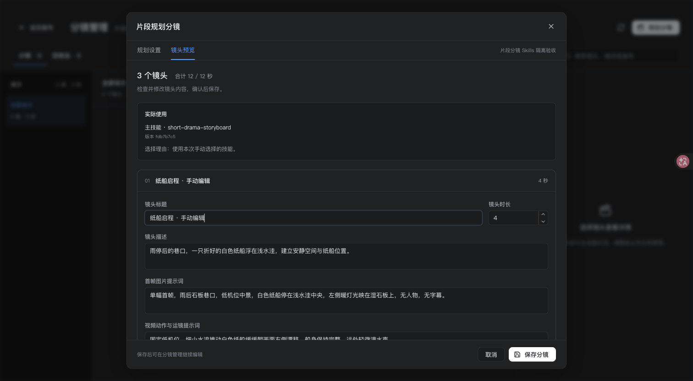
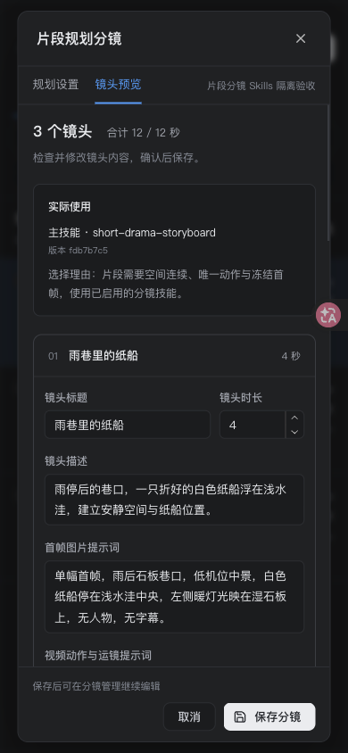
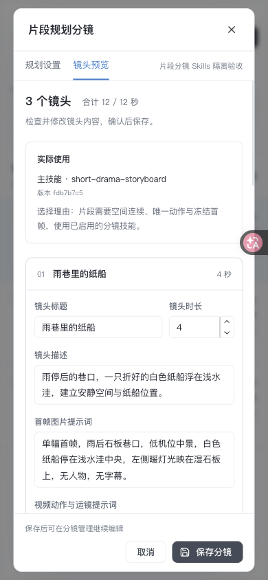
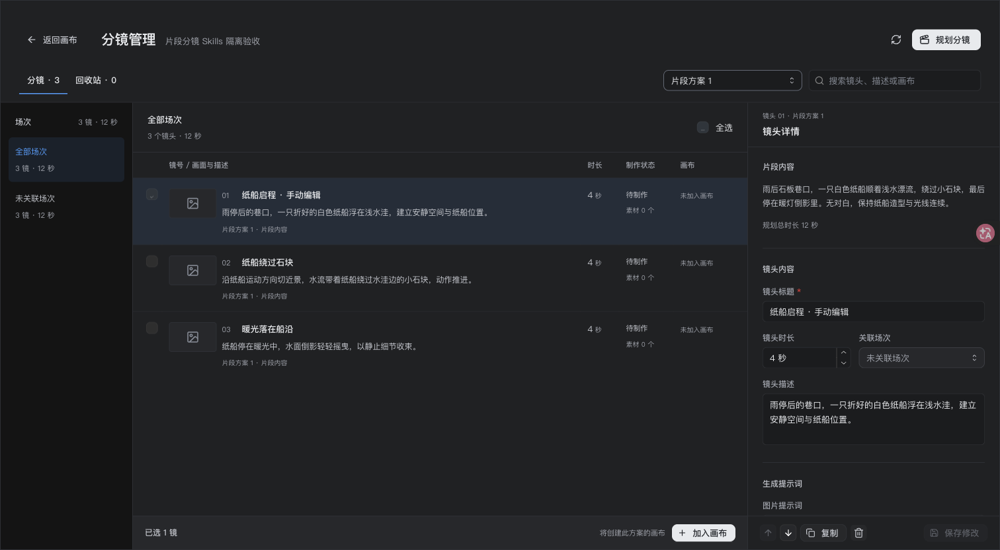

# 片段 Skills 分镜验收记录

日期：2026-11-04，Asia/Shanghai。实现、相关自动化、隔离 API 和浏览器业务验收已完成；专用验收服务与浏览器空间已关闭。变更保留在当前工作区，未提交、未推送。

## 验收目标

无剧本项目从一段视频内容开始，真实使用分镜环节的技能执行链规划镜头，预览编辑后独立保存，再从管理中仅选择需要的镜头进入制作。保存不得创建伪场次、剧本文档、参考设定、画布、节点或媒体任务，也不替换已有剧本方案。

## 自动化与构建

以下记录采用任务中已完成的测试与构建证据；文档整理只读取已有输出，没有重新执行测试。

| 验证范围 | 已知结果 | 主要覆盖 |
| --- | --- | --- |
| 后端片段与相关规划/管理回归 | 98 项通过 | 自动/手动技能正文加载、时长与配置签名、无场次保存、幂等、回收/跨项目/删除画布与所选镜头范围 |
| 分镜管理 | 18 项通过 | 来源选择、未保存保护、片段来源展示、方案筛选与制作交接 |
| 片段规划组件 | 13 项通过 | 输入、自动/手动技能、预览编辑、独立保存、刷新失败重试、晚响应与取消保护；规划/保存 409 后保留输入、确认丢弃旧预览并恢复配置 |
| 管理/画布集成 | 7 项通过 | 无剧本入口、保存后选中方案、片段专用接口和所选镜头交接、不误用剧本参考准备 |
| 最终前端联合回归 | 145/145 通过 | 8 个文件，覆盖片段、管理、画布、剧本规划、参考准备、生成及工具入口；包含上列前端分项，不重复相加 |
| 完整构建 | `npm run build` 退出码 0 | 架构检查、UI guard、shared/backend/web TypeScript 编译与 Vite 构建 |
| diff 检查 | 通过 | `git diff --check` |

已有命令与日志：

- `web` 目录：`node --import tsx --test test/clip-storyboard-planner.test.tsx`；`/tmp/clip-storyboard-planner-tests.log` 末尾为 `tests 13 / pass 13 / fail 0`。
- `web` 目录：`node --import tsx --test test/shot-manager.test.tsx`；`/tmp/clip-shot-manager-tests.log` 为 `tests 18 / pass 18 / fail 0`。
- `web` 目录：`node --import tsx --test test/canvas-shot-management-integration.test.tsx`；`/tmp/canvas-clip-integration-tests.log` 末尾为 `tests 7 / pass 7 / fail 0`。
- `backend` 目录最终源码联合命令：`node --import tsx --test test/clip-storyboard.test.ts test/storyboard-planning.test.ts test/shot-management.test.ts test/script-canvas-preparation.test.ts test/storyboard-design-migration.test.ts`；`/tmp/clip-storyboard-backend-regression.log` 为 `tests 98 / pass 98 / fail 0 / cancelled 0 / skipped 0`，退出码 0。另有片段单套 14/14 和 `npx tsc --noEmit -p tsconfig.json` 通过的分项记录，未重复计入联合总数。
- `web` 目录最终联合命令如下；日志 `/tmp/clip-storyboard-web-regression.log` 为 `tests 145 / pass 145 / fail 0`。

```sh
node --import tsx --test --test-concurrency=4 \
  test/clip-storyboard-planner.test.tsx \
  test/shot-manager.test.tsx \
  test/canvas-shot-management-integration.test.tsx \
  test/storyboard-planner.test.tsx \
  test/storyboard-production.test.tsx \
  test/script-canvas-preparation.test.tsx \
  test/script-generation.test.tsx \
  test/script-tools.test.tsx
```

根目录执行 `npm run build`，日志为 `/tmp/clip-storyboard-build.log`，退出码 0。Vite 提示压缩后部分 chunk 超过 500 kB，该提示未阻断构建。本次记录是相关范围回归与完整构建，没有将它表述为仓库所有测试全量通过。

## 隔离运行时与来源

数据目录为 `/tmp/studio-clip-skills-qa-20261104`；通过 `VIDEO_STUDIO_DATA_DIR` 连接专用新数据库。没有读取或写入用户业务数据库，没有改用户技能或默认配置。

| 项目 | 记录 |
| --- | --- |
| 前端 | `http://127.0.0.1:18890`，启动时 PID `24153` |
| 后端 | `http://127.0.0.1:18003` |
| 模型假上游 | `http://127.0.0.1:18004`；与后端同进程，启动时 PID `23606` |
| 浏览器主项目 | `51b2aff017e34f8091df0433d737e299` |
| 独立 API 验收项目 | `d1515fd3e6f74f769683b4aa39ed3eea`，与浏览器项目分开 |
| 文本模型 | `5d73b5c8bf5546f2a7dfa2921cefb20b`；`QA clip mock · 分镜文本模型`；上游标识 `qa-clip-text` |
| 技能 ID | `3dbf783e076b109a1f385c2f10006983`；`short-drama-storyboard` |
| 技能来源 | `zenstory-ai/drama-skills` / `skills/short-drama-storyboard` |
| 固定 revision | `fdb7b7c58017e3eae64eca382c2a85ede368dab0` |
| fixture | `/tmp/studio-skills-install-20261031/before-details.json` 中的完整公开缓存 bundle，共 14 文件，仅复制安装到新 QA 数据库 |
| 主技能文件 SHA-256 | `fec0a090c48b8939cdd5302937446faf2ffbbca26bf596e69e2b32dd8153067e` |

产品技能实际保存于 `installed_skills`，没有独立技能目录环境变量。本次使用现有安装及启用函数装入完整缓存副本；该版本只是隔离 fixture，不代表用户当前安装或启用版本。技能正文和附带资源仅作为产品模型输入数据，没有执行其中的文件操作、脚本或外部服务指令。

## 已完成的 API 业务验证

实际请求经过产品四个片段路由；仅上游模型由本地假服务替代。输入为雨后白色纸船随水漂流、绕过石块并停在暖光中的片段，12 秒、建议 3 镜。假服务返回 3 镜，每镜 4 秒。

| 检查 | 结果与证据 |
| --- | --- |
| 自动选技能 | 规划请求省略 `skill_ids`；实际 `select_creation_skills` 工具调用收到可用目录，假选择器返回 fixture ID，结果 `skill_assignment.source=automatic` |
| 手动选技能 | 规划请求显式传 fixture ID，结果为 `manual`，实际生成输入含相同技能正文 |
| 手动空选 | `skill_ids: []`，结果为手动基础规则，`used_skills=[]`；没有自动补选或注入外部技能正文 |
| 独立保存 | 返回 `scene_ids=[]`、`target_canvas_id=null`、3 个无 `source_scene_id` 的镜头；新增 1 方案及 1 片段来源记录 |
| 幂等重试 | 同一 `request_id`、相同内容返回 `replayed=true`，表计数不变 |
| 精确制作范围 | 仅提交首镜 ID，创建该片段方案画布，响应只返回该镜；不会返回其余 2 镜 |
| 非目标数据 | 独立保存前后场次、画布、节点、参考设定与任务计数保持 0；额外只读核对剧本来源文档、剧本产物、导演任务和文本响应均为 0 |

API 制作接口验收只证明画布创建/复用及所选镜头响应范围。此次 API 调用后 `canvas_nodes` 仍为 0；真实前端节点写入和重新进入画布的业务结果见下方独立浏览器验收。

保存前后与交接后的记录：

| 数据表 | 保存前 | 独立保存后 | API 交接后 |
| --- | ---: | ---: | ---: |
| `script_scenes` | 0 | 0 | 0 |
| `shots` | 0 | 3 | 3 |
| `storyboard_designs` | 0 | 1 | 1 |
| `storyboard_clip_plans` | 0 | 1 | 1 |
| `project_canvases` | 0 | 0 | 1 |
| `canvas_nodes` | 0 | 0 | 0 |
| `visual_profiles` | 0 | 0 | 0 |
| `jobs` | 0 | 0 | 0 |

## 浏览器业务与视觉验收

在独立浏览器主项目 `51b2aff017e34f8091df0433d737e299` 实际完成：

1. 无剧本项目直接进入片段分镜规划，输入 12 秒纸船片段；分别使用自动与手动分镜技能规划。
2. 在手动技能预览中把首镜标题改为「纸船启程 · 手动编辑」，独立保存，重新进入管理并选中「片段方案 1」。
3. 仅选首镜加入方案专属画布；请求只携带首镜 ID，实际创建 1 个首镜图片生成节点。画布另含既有约定的空 `project_script_ref` 节点，其文本为空，不代表创建了剧本文档或场次。
4. 回管理仅选第二镜，再次加入同一专属画布；只增加 1 个第二镜节点，首镜节点 ID 保持不变且无重复，第三镜未加入。
5. 桌面与 390px 下实际查看深色/浅色的规划设置、镜头预览和技能选择，未观察到横向溢出。关闭未保存预览会出现确认，已实际检查。

[浏览器证据](browser-verification.json) 的 32 个检查均为 `true`：保存增量仅为 3 镜头、1 方案、1 片段来源记录；场次、参考设定、任务、画布和节点的保存增量为 0。首次制作才新增专属画布，第二次复用不再新增画布、方案或镜头。全程没有 `/script/canvas` 检查、准备或确认请求，实际剧本、参考和媒体任务表计数保持 0。

手动 `[]` 的基础规则路径由 API 和组件测试覆盖；409 配置冲突恢复由组件测试覆盖，本记录不把这两项计入浏览器实测。浏览器后续深浅色检查只再次规划，没有新增保存提交；最终状态留在临时 `browser-final-stats.json` 中。

代表截图：



| 390px 深色预览 | 390px 浅色预览 |
| --- | --- |
|  |  |



## 实际技能输入证据

API 验收中自动选择和手动选择的生成请求均为 40,496 字节，浏览器中两类请求均为 40,520 字节；都包含主技能名/固定版本头及以下 4 条独特正文特征。API 手动空选为 2,346 字节，主技能头和 4 条特征均缺席：

- `起点 → 唯一动作 → 终点`
- `冻结关键帧只投影镜头起点`
- `切镜必须带来信息、权力、情绪、空间或节奏变化`
- `视频模型不会删掉多出来的动作，而是把它们压到看不清`

这证明当前调用链加载了真实技能正文，并遵守自动/手动/空选契约。假选择器固定返回可用 fixture ID，假生成器固定返回同一合法镜头 JSON；不能据此推断真实模型会正确选技能、遵守规则、提高分镜质量或生成可用视频。未调用真实计费模型，未发起媒体生成任务。服务进程阻止所有非本地假上游端口的 outbound fetch；日志仅记录请求范围、哈希和规则命中，不记录密钥。

## 归档证据

以下 3 份脱敏 JSON 与 4 张截图已复制到本验收目录，以相对路径引用；不包含数据库、密钥、完整技能 bundle 或原始服务配置：

- [API 验收结果](api-verification.json)：保存/重试/所选交接、表计数与技能输入检查。
- [浏览器业务证据](browser-verification.json)：32 个检查、真实前端节点、精确首/次镜交接、固定技能版本和实际空表核对。
- [技能来源与哈希](skill-provenance.json)：fixture 固定来源、revision、文件数与主文件哈希。
- [桌面手动技能预览](clip-manual-preview-desktop.png)、[390px 深色](clip-preview-mobile-dark.png)、[390px 浅色](clip-preview-mobile-light.png)、[仅选首镜](clip-select-one.png)。

其余辅助文件保留在本机临时目录 `/tmp/studio-clip-skills-qa-20261104`，不是长期归档：

- `manifest.json`：运行时端口、项目、模型与技能标识。
- `skill-bundle.json`：真实公开 fixture 的完整缓存副本，仅用于本次隔离安装。
- `mock-requests.jsonl`：自动选技能工具请求、生成请求哈希与正文规则命中。
- `api-requests.jsonl`：产品路由、参数字段名、技能 ID 和所选镜头范围。
- `readonly-counts.json`：API 验收后的隔离数据库只读核对；记录时间为 2026-11-04 01:06:19 +08:00。
- `runtime.mts`、`verify-api.mts`：隔离服务与 API 验收脚本。
- `browser-final-stats.json`：后续主题/窄屏检查后的最终隔离状态。

早期 stats 使用了不存在的 `script_documents` 名称，报告该项为 `null`；此值不作为剧本文档不存在的证据。文档类数据以归档浏览器证据中实际读取的 `scripts`、`script_source_documents`、`script_artifacts` 表计数及临时 `readonly-counts.json` 为准。

## 收尾与适用范围

- [x] 无剧本片段→自动/手动技能→预览编辑→独立保存→重进管理→精确首镜与次镜制作。
- [x] 未保存预览关闭确认、桌面/390px、深色/浅色设置与预览/技能选择检查。
- [x] 相关后端回归、前端最终 145 项联合回归、类型/UI/架构检查、完整构建与 diff 检查。
- [x] 技能实际输入和制作交接边界复核，归档验证范围及限制。
- [x] 浏览器 `Ego TaskSpace6.finish({keep: []})` 成功，仅调用一次；专用前端 PID `24153`、后端/假上游 PID `23606` 已发送 TERM，随后 `lsof` 确认 `18890`、`18003`、`18004` 均无监听。

用户原有前端 `8888`（PID `15087`）和后端 `8000`（PID `43439`）保持监听，未重启用户主后端。新数据库迁移及片段路由需要主后端重启后生效。当前实现未提交、未推送；没有通过本次假上游验收测量真实模型的选择/规划质量或最终视频效果。
